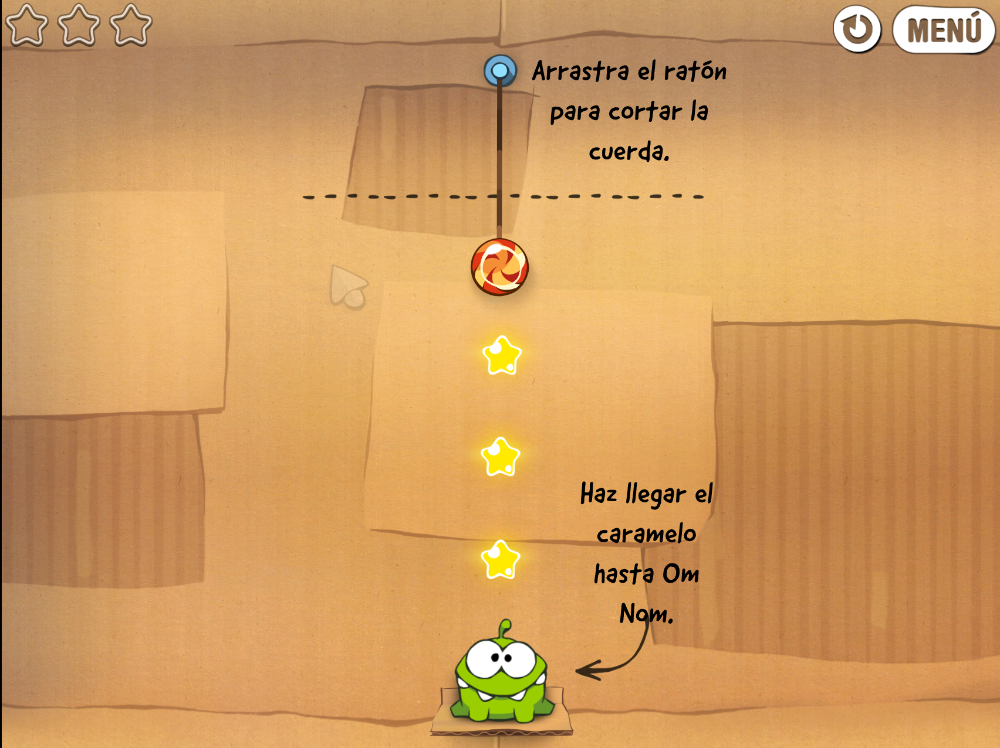

# Cut the Rope — Visual Computing 2026-II

Recreación de *Cut the Rope* en el navegador con p5.js: los 25 niveles de la primera caja (Cardboard Box), con cuerdas, cuerdas automáticas, burbujas, púas, estrellas, tutoriales, música y efectos.

| |
|---|
|  |

**Jugar en línea:** [https://shryhakakizuki.github.io/Cut_The_Rope-Visual_Computing_2026-II/](https://shryhakakizuki.github.io/Cut_The_Rope-Visual_Computing_2026-II/)

## Integrantes

| Integrante | GitHub |
|---|---|
| Oscar Leonardo Riveros Perez | [ShryhakAkizuki](https://github.com/ShryhakAkizuki) |
| Camilo Londoño Moreno | [CamiloLM](https://github.com/CamiloLM) |
| Omar Nicolas Guerrero Guerrero | [camisabo](https://github.com/camisabo) |
| Oscar Ivan Ulises Gutierrez Palacios | [10scar](https://github.com/10scar) |

## Cómo jugar

Lleva el dulce hasta Om Nom y recoge las estrellas por el camino. Cada nivel da hasta 3 estrellas; el puntaje suma 1000 por estrella más un bonus por rapidez. Ganar un nivel desbloquea el siguiente y el progreso se guarda en el navegador.

| Control | Acción |
|---|---|
| Arrastrar el ratón sobre una cuerda | Cortarla |
| Clic en la burbuja que lleva el dulce | Reventarla |
| `P` o `Escape` | Pausar / continuar |
| `R` | Reiniciar el nivel |
| `Enter` / `Escape` | En el título, abrir el menú de niveles / en los menús, volver al título |

Las cuerdas automáticas (círculo punteado) se unen al dulce cuando se acerca; las púas lo rompen; el menú de pausa permite saltar un nivel.

## Correr en local

El juego no necesita nada que instalar; basta con servir la carpeta `src/`:

```bash
python -m http.server 8000 -d src
```

y abrir http://localhost:8000.

Para desarrollar (linter, despliegue y guías de extensión), ver [Desarrollo](docs/06-desarrollo.md).

## Tecnologías

JavaScript con módulos ES, sin build (p5.js y Matter.js siguen como `<script>` de librería):

- [p5.js](https://p5js.org/): dibujo, entrada y game loop.
- Física de Verlet propia ([`src/core/verlet.js`](src/core/verlet.js)), portada de Cut the Rope DX: el dulce y las cuerdas son cadenas de puntos con restricciones de distancia.
- [Matter.js](https://brm.io/matter-js/): solo detección de sensores (Om Nom, burbujas, púas).
- Web Audio API para el sonido.

## Estructura

```
src/
├── index.html
├── core/       Game (estados y bucle), Level, cámara, Verlet, progreso, audio, adaptador p5
├── entities/   Dulce, cuerdas, anclas, Om Nom, estrellas, burbujas, púas
├── ui/         Sprites y fuentes, HUD, pausa, resultados, título, créditos, menú de niveles, tutoriales
├── data/       Constantes, los 25 niveles, textos y créditos
├── libraries/  p5.js y Matter.js
└── assets/     Imágenes (hojas + atlas), sonidos y fuente
```

## Documentación

Versión final del proyecto. La documentación completa vive en [`docs/`](docs/README.md):

| Documento | Contenido |
|---|---|
| [Arquitectura](docs/01-arquitectura.md) | Estados, capas, game loop, cámara, entrada y orden de carga |
| [Física y mecánicas](docs/02-fisica.md) | Verlet, cuerdas y corte, burbujas, estrellas, púas, movimiento |
| [Niveles](docs/03-niveles.md) | Formato de `LEVELS`, coordenadas y cómo agregar un nivel |
| [Sonido](docs/04-sonido.md) | Arquitectura Web Audio, canales, música y silencio |
| [Assets](docs/05-assets.md) | Hojas de sprite, fuentes, sonido y de dónde salen |
| [Desarrollo](docs/06-desarrollo.md) | Entorno local, linter, despliegue y guías de extensión |

## Créditos

Los niveles, las imágenes, los sonidos y el comportamiento de referencia vienen del proyecto de fans [Cut the Rope DX](https://github.com/yell0wsuit/cuttherope-dx). *Cut the Rope*, sus personajes y sus assets son propiedad de ZeptoLab. Este es un proyecto académico sin fines comerciales.
