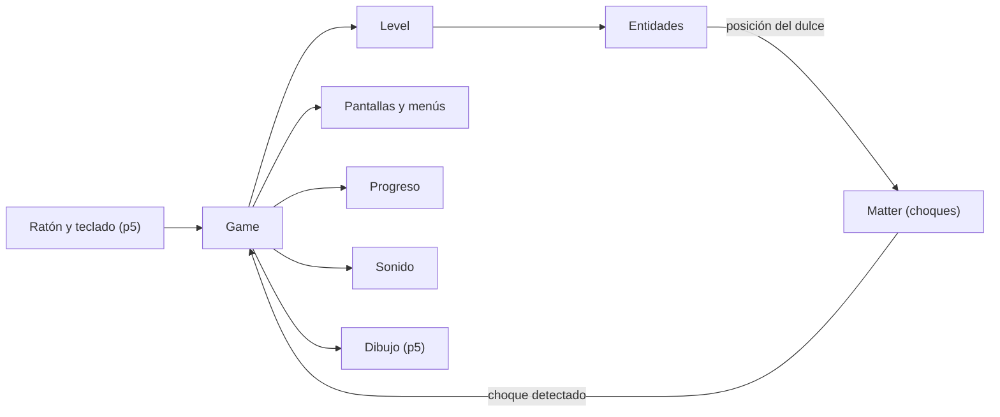
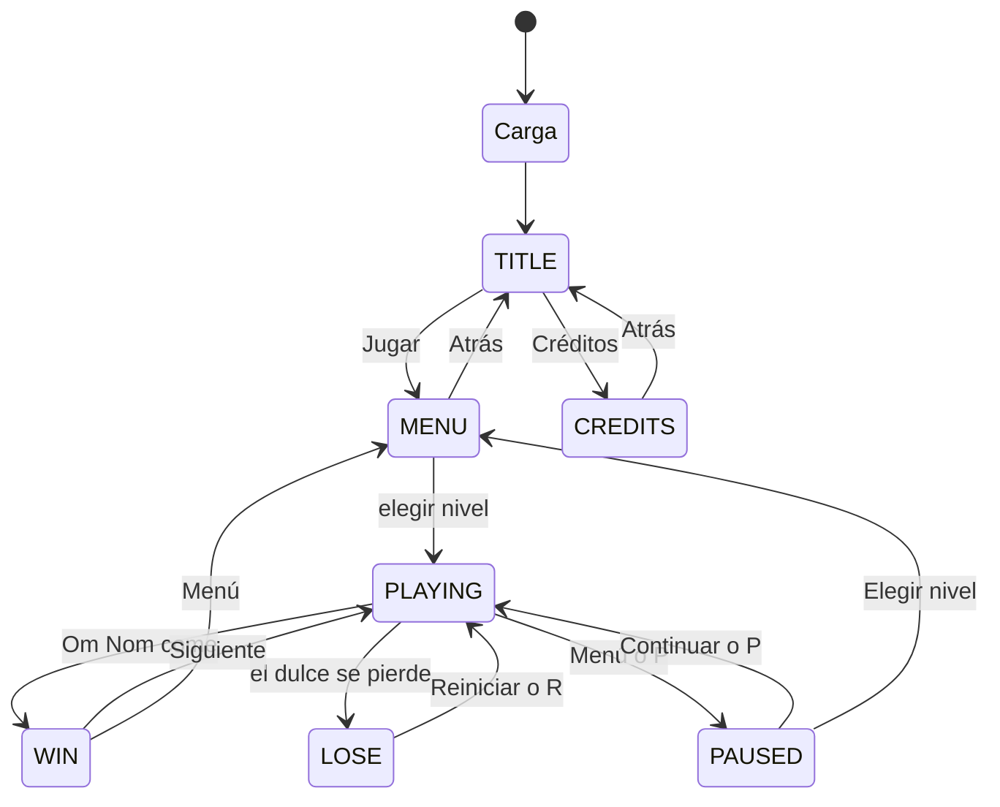

# 1. Arquitectura

Visión general de la recreación de *Cut the Rope* para Visual Computing 2026-II: un sitio estático, sin build, publicado en GitHub Pages, hecho con JavaScript plano (módulos ES) y p5.js.

Documentos relacionados: [física y mecánicas](02-fisica.md) · [niveles](03-niveles.md) · [sonido](04-sonido.md) · [assets](05-assets.md) · [desarrollo](06-desarrollo.md).

---

## 1.1. Resumen

Cada librería hace una sola cosa:

| Pieza | Qué hace |
|---|---|
| **p5.js** | Dibuja en un canvas de 1920×1440 que se escala a la ventana y lee el ratón y el teclado |
| **Verlet** ([`src/core/verlet.js`](../src/core/verlet.js)) | Mueve el dulce y las cuerdas. Se usa en vez de Matter porque una cuerda se estira, se balancea y, al cortarla, cada trozo sigue cayendo; con los cuerpos rígidos de Matter solo se podía imitar. Es lo que hace Cut the Rope DX, así el dulce se mueve igual que en sus mapas |
| **Matter.js** | Solo avisa cuando el dulce toca algo (Om Nom, una burbuja, unas púas) |
| **Lógica propia** | Estados, reloj, puntaje, progreso y sonido |



[`src/core/main.js`](../src/core/main.js) es solo un adaptador: pasa la entrada a `Game`, escala el canvas y pausa el juego cuando cambias de pestaña. Toda la lógica vive en [`Game`](../src/core/game.js).

---

## 1.2. Pantallas y estados

Los nombres de estado están en [`STATE`](../src/data/config.js#L4) (`src/data/config.js`).



| Estado | Qué se ve |
|---|---|
| `TITLE` | Logo y botones Jugar y Créditos |
| `CREDITS` | Datos del curso y nombres de los estudiantes |
| `MENU` | Cuadrícula de niveles con candados y estrellas |
| `PLAYING` | El nivel con su HUD (estrellas, Reiniciar, Menú) |
| `PAUSED` | El nivel congelado con el menú de pausa |
| `WIN` | Panel con estrellas, puntaje y botones Repetir, Siguiente y Menú |
| `LOSE` | Cartel "¡Oh, no!" |

Solo en `PLAYING` avanzan la física y el reloj; en cualquier otro estado todo queda congelado. Reiniciar siempre reconstruye el nivel desde cero (`Game.restart` llama a `startLevel` de nuevo). Si cambias de pestaña a mitad de un nivel, el juego se pausa solo y se reanuda al volver; una pausa manual no se reanuda sola.

---

## 1.3. Piezas del código

| Archivo | Para qué sirve |
|---|---|
| [`src/core/main.js`](../src/core/main.js) | Conecta p5 con `Game` y muestra la pantalla de carga |
| [`src/core/game.js`](../src/core/game.js) | Lógica del juego: estados, reloj, puntaje, pausa y reacción a los choques |
| [`src/core/level.js`](../src/core/level.js) | Convierte los datos de un nivel en objetos y los dibuja |
| [`src/core/camera.js`](../src/core/camera.js) | Cámara vertical (solo el nivel 15) |
| [`src/core/verlet.js`](../src/core/verlet.js) | Los puntos que se mueven por Verlet |
| [`src/core/collisions.js`](../src/core/collisions.js) | Traduce los eventos de `collisionStart` de Matter a reacciones de `Game` |
| [`src/core/state-input.js`](../src/core/state-input.js) | Enrutador de clics y teclas según el estado actual |
| [`src/core/progress.js`](../src/core/progress.js) | Guarda estrellas, puntajes y niveles desbloqueados en el navegador |
| [`src/core/rules.js`](../src/core/rules.js) | Cálculo del puntaje |
| [`src/core/audio.js`](../src/core/audio.js) | Música y efectos (ver [Sonido](04-sonido.md)) |
| [`src/entities/`](../src/entities/) | Los objetos del nivel: cada uno sabe dibujarse, pero no decide nada del juego |
| [`src/ui/`](../src/ui/) | Menús, HUD, botones, tutoriales y pantalla de carga |
| [`src/data/`](../src/data/) | Constantes, niveles, textos y créditos |

Objetos del nivel:

| Objeto | Qué es |
|---|---|
| `Candy` | El dulce; se rompe con las púas |
| `Rope` | Una cuerda: se puede cortar y sus trozos siguen cayendo |
| `Anchor` | Gancho donde empieza una cuerda |
| `AutoAnchor` | Gancho que crea su cuerda cuando el dulce se acerca |
| `OmNom` | El monstruo que hay que alimentar |
| `Star` | Estrella coleccionable |
| `Bubble` | Burbuja que sube al dulce; se revienta con un clic |
| `Spikes` | Púas, quietas o en movimiento |
| `Mover` | El patrón de movimiento (path) que comparten estrellas, púas y el dedo de los tutoriales |

Para añadir una mecánica nueva: crea el objeto en `entities/`, constrúyelo en `Level.build` y haz que `Game` reaccione cuando el dulce lo toque. La guía completa está en [Desarrollo](06-desarrollo.md).

---

## 1.4. Qué pasa en cada frame

Mientras se juega, `Game.update` repite esto 60 veces por segundo:

1. Avanza el reloj (solo cuando la cámara no está haciendo el paneo inicial) y mueve las púas y estrellas que se desplazan.
2. Mueve las cuerdas y luego el dulce, con un paso de física 1,4 veces más grande que el de la simulación para que la cuerda se sienta más fluida (`ROPE_T` en [`config.js`](../src/data/config.js#L14)).
3. Aplica el empuje de la burbuja, si el dulce está dentro de una.
4. Sincroniza el cuerpo de Matter del dulce con su posición Verlet.
5. Comprueba si el dulce tocó alguna estrella (antes que los choques de Matter, para no perder una estrella recogida en el mismo instante de la victoria).
6. Pregunta a Matter si hubo choques (`collisionStart`).
7. Actualiza las cuerdas automáticas y los tutoriales.
8. Reacciona: el dulce se atrapa en una burbuja, se rompe en unas púas o llega a Om Nom (ganas).
9. Si el dulce salió del mapa, pierdes.
10. Dibuja todo (`Game.draw`), con el nivel desplazado por la cámara.

---

## 1.5. Cámara vertical

La mayoría de los mapas caben en la pantalla de 1920×1440; solo el nivel 15 es más alto y usa la cámara de [`src/core/camera.js`](../src/core/camera.js). La cámara solo se mueve en el eje vertical: `Camera.y` es el desplazamiento y `toWorld` lo convierte de pantalla a mundo.

Comportamiento:

- **Paneo inicial:** al empezar el nivel, la cámara parte del borde opuesto al dulce (si el dulce está arriba, la cámara empieza abajo) y viaja hasta enmarcarlo. Acelera hasta `CAMERA_T.panMaxSpeed`, decelera al pasar la mitad del recorrido y termina a `panMinSpeed`.
- **Acelerar:** mientras queda más de `CAMERA_T.inputEnableDistance` de recorrido, la cámara bloquea la entrada; un clic la acelera (`hurry`) multiplicando la velocidad por `hurryFactor`, hasta `hurryMaxSpeed`.
- **Seguimiento:** terminado el paneo, la cámara sigue al dulce con suavizado exponencial (`followRate`).

El reloj del nivel no avanza durante el paneo, así el bonus de tiempo no se gasta en la animación de entrada.

---

## 1.6. Entrada

[`src/core/state-input.js`](../src/core/state-input.js) es una tabla estado → manejadores: `dispatchClick` y `dispatchKey` consultan el estado actual y llaman al manejador correspondiente. Los eventos llegan desde p5 vía `Game.onInput` / `Game.onKeyDown`.

| Entrada | Efecto |
|---|---|
| Arrastrar | Corta una cuerda (como mucho una por arrastre); durante el paneo del nivel 15, la entrada está bloqueada |
| Clic | Botones, niveles y burbujas según el estado; en `LOSE`, reinicia; durante el paneo del nivel 15, acelera la cámara |
| `R` | Reinicia el nivel |
| `P` o `Escape` | Pausa o reanuda (solo `PLAYING` / `PAUSED`) |
| `Enter` | En el título, abre el menú de niveles |
| `Escape` | En el menú de niveles y los créditos, vuelve al título |

Durante `PAUSED`, el menú de pausa ofrece Continuar, Silencio, Reiniciar, Saltar nivel y Menú.

---

## 1.7. Progreso y puntaje

El progreso lo maneja [`ProgressStore`](../src/core/progress.js) y se guarda en `localStorage` bajo la clave `ctr_progress_v1` ([`PROGRESS_KEY`](../src/data/config.js#L245)): por nivel guarda `bestStars`, `bestScores`, `completed` y `unlocked`. Al cargar, los datos se validan contra la lista de niveles (las estrellas se recortan al máximo del nivel), de modo que un progreso viejo o corrupto nunca rompe el menú.

- Ganar desbloquea el siguiente nivel; "Saltar nivel" en la pausa también.
- El botón de silencio es independiente: `ctr_muted_v1` (ver [Sonido](04-sonido.md)).

El puntaje lo calcula [`calculateScore`](../src/core/rules.js): `1000 × estrellas` más `100` por cada segundo que sobre de 30. El panel de victoria muestra el detalle y, si superaste tu mejor puntaje, lo anuncia.

---

## 1.8. Estructura de carpetas y módulos

```
src/
├── index.html
├── libraries/   p5 y Matter
├── data/        constantes, niveles, textos y créditos
├── core/        juego, nivel, cámara, progreso, reglas, audio y física
├── entities/    objetos del nivel
├── ui/          menús, HUD, sprites y fuentes
└── assets/      imágenes, sonidos y fuentes
```

El código del proyecto usa **módulos ES**: cada archivo declara sus `export` y los consume con `import`; [`src/index.html`](../src/index.html) solo carga las librerías (p5, Matter) y un `<script type="module" src="core/main.js">`, y el navegador resuelve el grafo de imports desde ahí. **Un archivo nuevo no hay que registrarlo en ningún lado: solo exportar e importarlo.** p5.js y Matter.js se quedan en modo global (`window.p5`, `window.Matter`); [`src/core/main.js`](../src/core/main.js) asigna `window.preload/setup/draw/...` para que el modo global de p5 los encuentre, y `Matter` se usa por el nombre global.

---

## 1.9. Despliegue

Cada push a `main` publica `src/` en GitHub Pages ([`.github/workflows/deploy.yml`](../.github/workflows/deploy.yml)). Para deshacer un despliegue, revierte el commit y haz push. Detalles en [Desarrollo](06-desarrollo.md).
