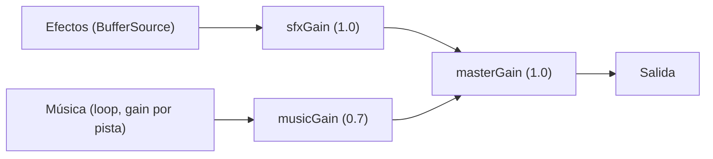

# 4. Sonido

Todo el audio se maneja con la Web Audio API en el objeto singleton [`Sound`](../src/core/audio.js) (`src/core/audio.js`). No hay librerías de audio: se carga, se decodifica y se reproduce con `AudioBuffer`. Los nombres de archivo y volúmenes están en `AUDIO_T` de [`src/data/config.js`](../src/data/config.js).

Documentos relacionados: [arquitectura](01-arquitectura.md) · [assets (lista de archivos)](05-assets.md).

---

## 1. Carga y decodificación

- `Sound.init()` se ejecuta al importar el módulo: lee el estado de silencio guardado, crea el contexto y sus ganancias, arma el desbloqueo por gesto y carga **todo** de una vez (`loadAll`).
- Cada archivo se descarga con `fetch`, se decodifica con `decodeAudioData` y queda en `buffers` bajo la clave `sfx:nombre` o `music:nombre`.
- Si un archivo falla (404, decodificación), se registra en `failed` y se avisa en consola, pero el juego no se cae: el sonido simplemente no suena.

## 2. Canales de mezcla

- **SFX** suenan de uno en uno, sin cola: cada `play(name)` crea un `BufferSource` efímero hacia `sfxGain`.
- **Música** es un `BufferSource` con `loop = true`. Al cambiar de pista se hace un fundido de salida (`musicFadeMs = 250`) con `linearRampToValueAtTime` antes de detener la anterior.

## 3. Música por estado

| Estado(s) | Pista |
|---|---|
| `TITLE`, `MENU` | `menu_music.mp3` |
| `PLAYING` (y subestados `PAUSED`/`WIN`/`LOSE`, que no la detienen) | `game_music.mp3` |

`Game.showTitle/showMenu` piden `playMusic('menu')` y `Game.startLevel` pide `playMusic('game')`. El cambio es con fundido, nunca un corte seco.

## 4. Efectos

Los efectos se piden por nombre lógico (`Sound.play('star2')`) y se resuelven contra `AUDIO_T.sfx`; un nombre desconocido avisa una sola vez en consola. Momentos especiales:

- **Corte de cuerda:** el sonido (`cut1`…`cut4`) depende de lo tensa que estaba la cuerda al cortarla (ver [física §3](02-fisica.md)).
- **Om Nom:** la boca se abre cuando el dulce queda a menos de `AUDIO_T.mouthOpenDistance` y se cierra tras `mouthCloseDelay` de alejarse. El saludo al llegar al menú de niveles (`greetDelay`) y las reacciones aleatorias (saludar, emocionarse con estrella, triste al perder) pasan por `omnomVoiceChance` (50 %) para no saturar.
- **Sonidos programados:** `Game.scheduleSound` permite disparar un efecto `t` segundos después (se usa para el saludo de Om Nom).

## 5. Desbloqueo y visibilidad

Los navegadores inician el `AudioContext` en estado `suspended` hasta que hay un gesto del usuario:

- **Desbloqueo:** `armUnlock` escucha `pointerdown`, `mousedown`, `touchend` y `keydown` (en captura) y llama a `ctx.resume()`; en cuanto el contexto queda `running`, se desarma.
- **Visibilidad:** al ocultar la pestaña el contexto se `suspend()`a (ahorra CPU y evita música "por detrás"); al volver se reanuda, o se vuelve a armar el desbloqueo si el navegador lo dejó suspendido.

## 6. Silencio

El botón de silencio (título, menú y pausa) llama a `Sound.toggleMute()`, que apaga `masterGain` (0 o 1) y guarda la elección en `localStorage` bajo `ctr_muted_v1`. La opción se lee en `init()`, así que persiste entre sesiones.

## 7. Tabla de efectos

| Evento | Archivo |
|---|---|
| Cortar cuerda | `rope_bleak_1` … `rope_bleak_4` |
| Aparece una autocuerda | `rope_get` |
| Estrellas | `star_1`, `star_2`, `star_3` |
| Burbuja atrapa / revienta | `bubble`, `bubble_break` |
| Dulce destruido por púas | `candy_break` |
| Om Nom | `monster_open`, `monster_close`, `monster_chewing`, `monster_sad`, `monster_greeting`, `monster_excited` |
| Ganar | `win` |
| Botones y pausa | `tap`, `pause_down`, `pause_up` |
| Música de menús y de juego | `menu_music.mp3`, `game_music.mp3` |
