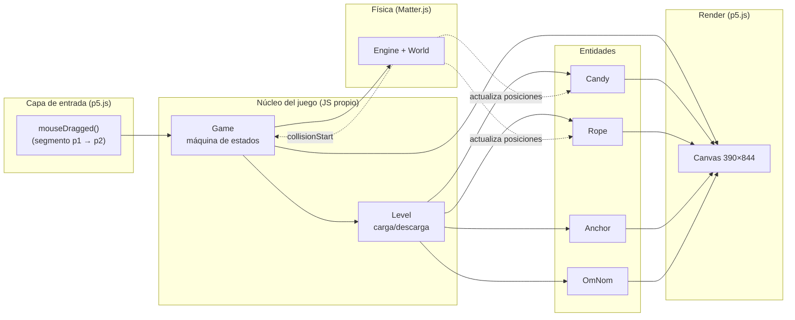
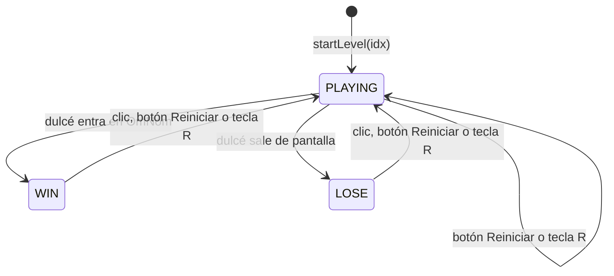
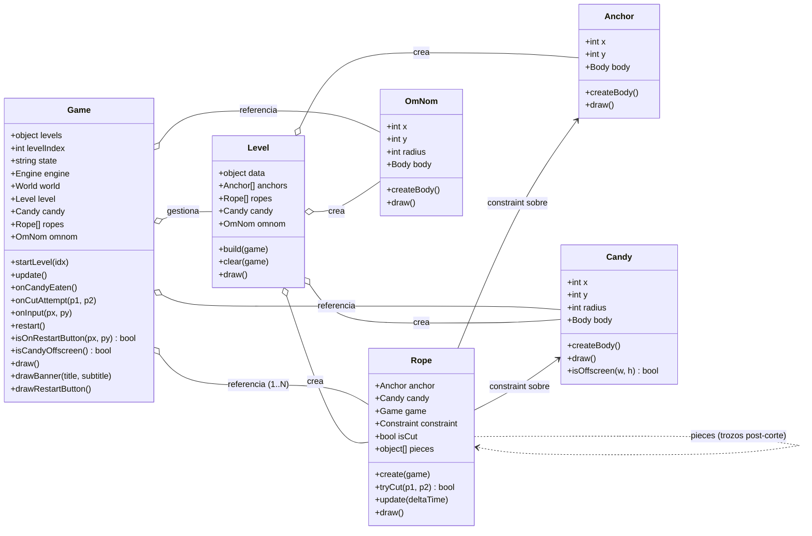
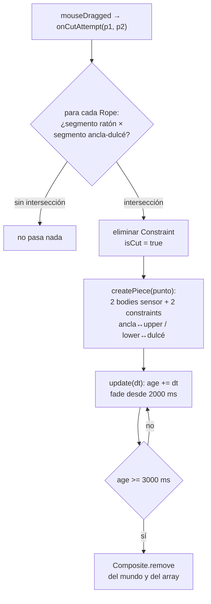
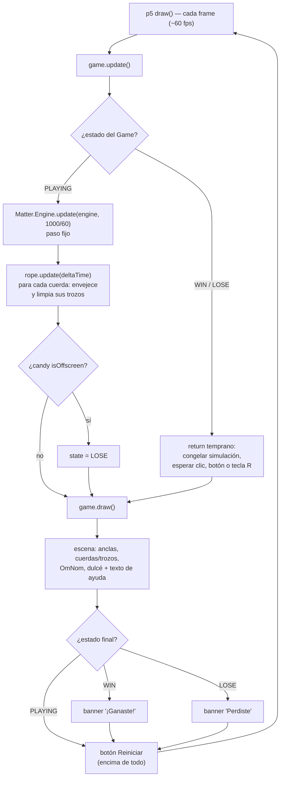

# Arquitectura MVP — Recreación de *Cut the Rope*

> Proyecto: Visual Computing 2026-II
> Stack: **JavaScript + p5.js (render/input) + Matter.js (física)** — 100% estático, sin build, listo para GitHub Pages.

---

## Tabla de contenidos

1. [Resumen del sistema](#1-resumen-del-sistema)
2. [Alcance de la MVP](#2-alcance-de-la-mvp)
3. [Estados del juego](#3-estados-del-juego)
4. [Arquitectura por componente](#4-arquitectura-por-componente)
5. [Corte de cuerda y trozos](#5-corte-de-cuerda-y-trozos)
6. [Estructura de archivos](#6-estructura-de-archivos)
7. [Game loop](#7-game-loop)
8. [Fuera de alcance de la MVP](#8-fuera-de-alcance-de-la-mvp)

---

## 1. Resumen del sistema

El juego se resuelve con **tres responsabilidades bien separadas**:

| Capa | Tecnología | Responsabilidad |
|---|---|---|
| **Física** | Matter.js | Gravedad, cuerpo del dulcé, constraints (cuerdas y trozos), colisiones (OmNom como sensor) |
| **Render + Input** | p5.js | Dibujar la escena, detectar arrastre del ratón, game loop |
| **Lógica de juego** | JS propio | Máquina de estados (jugando/ganado/perdido), detección de corte, reinicio |

Diagrama de alto nivel:



**Idea central:** p5.js **no** usa el renderizador de Matter (`Matter.Render` ni canvas de Matter). Solo usamos `Matter.Engine` para simular, y p5.js dibuja todo a partir de las posiciones de los bodies. Esto da control total del visual y un solo canvas en pantalla.

---

## 2. Alcance de la MVP

### ✅ Dentro (lo mínimo jugable)

1. **Niveles definidos por datos** (`LEVELS` en [`levels.js`](../src/levels.js)): 3 niveles, cada uno con posiciones de dulcé, anclas y OmNom; el nivel inicial se elige con `LEVEL_INDEX` en [`main.js`](../src/main.js).
2. **Dulcé (candy)**: cuerpo circular (`restitution: 0.3`, `frictionAir: 0.01`, `friction: 0.05`) que cuelga de las cuerdas.
3. **Cuerdas**: cada ancla fija (`anchors` en los datos del nivel) crea su propio constraint recto (`stiffness: 1`) hacia el dulcé; el dulcé solo cae cuando se cortan todas.
4. **Anclas**: bodies estáticos y sensor (`Anchor`), renderizadas como dos círculos concéntricos.
5. **Corte**: arrastrar el ratón a través de la cuerda la elimina; la cuerda se convierte en **dos trozos físicos** que cuelgan y se desvanecen (ver [sección 5](#5-corte-de-cuerda-y-trozos)).
6. **OmNom (objetivo)**: círculo estático sensor; si el dulcé lo toca → **GANASTE** (evento `collisionStart` con labels `candy`/`omnom`).
7. **Derrota**: el dulcé sale de la pantalla por **cualquier borde** (margen = su radio) → **PERDISTE**.
8. **Reinicio**: botón **Reiniciar** (esquina inferior izquierda del canvas, con el texto de ayuda a su derecha) o tecla `R` en cualquier momento; tras ganar o perder, también un clic en cualquier parte.
9. Render básico con formas (círculos + líneas), banner de resultado, botón de reinicio y texto de ayuda.

### ❌ Fuera de la MVP (ver [sección 8](#8-fuera-de-alcance-de-la-mvp))

Selector de niveles, estrellas, sonido, touch, etc.

---

## 3. Estados del juego

Máquina de estados mínima de 3 estados (constante `STATE` en [`game.js`](../src/game.js)):



| Estado | `update()` hace | `draw()` hace |
|---|---|---|
| `PLAYING` | Avanza `Matter.Engine.update(engine, 1000/60)`, actualiza trozos de cuerda, evalúa salida de pantalla | Escena completa + texto de ayuda + botón Reiniciar |
| `WIN` | **Congela la simulación** (return temprano; no llama a `Engine.update`) y espera input de reinicio | Escena congelada + banner "¡Ganaste!" + botón Reiniciar |
| `LOSE` | **Congela la simulación** igual que `WIN` y espera input de reinicio | Escena congelada + banner "Perdiste" + botón Reiniciar |

> Decisión de diseño: **al terminar el nivel (ganar o perder), la simulación se congela** — la escena se queda en el último frame hasta reiniciar. Todo reinicio termina en `restart()` → `startLevel(levelIndex)`, que limpia el mundo y reconstruye el nivel completo:
> - `onInput(px, py)` reinicia si el clic cae en el botón Reiniciar (en cualquier estado), o con un clic en cualquier parte si el estado es `WIN` o `LOSE`.
> - La tecla `R` llama a `restart()` directamente, en cualquier estado.

---

## 4. Arquitectura por componente

### Diagrama de clases



### Tabla de responsabilidades

| Clase / archivo | Responsabilidad | **No hace** |
|---|---|---|
| `Game` ([`game.js`](../src/game.js)) | Máquina de estados, crea el `Engine` (gravedad `y = 1`), orquesta `update()`/`draw()`, escucha `collisionStart`, reinicio, banners, botón de reinicio (`RESTART_BUTTON`: dibujo y prueba de clic) | No dibuja las entidades, no define niveles |
| `Level` ([`level.js`](../src/level.js)) | Traduce los datos del nivel en entidades (dulcé, OmNom, anclas + cuerdas); limpia el mundo (`Composite.clear`) al cambiar de nivel; delega el `draw()` | No tiene lógica de gameplay |
| `Anchor` ([`anchor.js`](../src/anchor.js)) | Su `Body` circular estático + sensor (radio 8), render | No se mueve, no decide nada |
| `Candy` ([`candy.js`](../src/candy.js)) | Su `Body` circular con label `candy`, render, `isOffscreen()` (los 4 bordes, margen = radio) | No decide cuándo se gana |
| `Rope` ([`rope.js`](../src/rope.js)) | Su `Constraint` ancla→dulcé, `tryCut()` (intersección de segmentos), creación y ciclo de vida de los trozos post-corte, render de línea/trozos | No lee el ratón directamente |
| `OmNom` ([`omnom.js`](../src/omnom.js)) | Su `Body` circular estático + sensor con label `omnom`, render | No detecta colisiones (eso lo hace Matter) |
| datos ([`levels.js`](../src/levels.js)) | Constante `LEVELS`: array de 3 niveles con `name`, `candy`, `anchors`, `omnom` (solo datos) | Sin lógica |
| [`main.js`](../src/main.js) | Adaptador p5: `setup()`/`draw()`, `LEVEL_INDEX`, conecta `mouseDragged` → `onCutAttempt`, `mousePressed` → `onInput(mouseX, mouseY)` y la tecla `R` → `restart()` | Cero lógica de juego |

**Regla de oro de la MVP:** cada archivo es pequeño y con un solo trabajo. `main.js` cabe en ~30 líneas.

---

## 5. Corte de cuerda y trozos

El corte es el comportamiento más "físico" de la MVP y vive enteramente en [`rope.js`](../src/rope.js):

1. **Detección** — `tryCut(p1, p2)` recibe el segmento del arrastre del ratón y lo interseca con el segmento ancla→dulcé usando `segmentIntersection()` (producto cruzado; devuelve el punto solo si la intersección cae dentro de ambos segmentos). Si ya está cortada o no hay intersección, no hace nada.
2. **Remoción** — al cortar, el `Constraint` original se elimina del mundo y `isCut = true`.
3. **Trozos** — `createPiece(point)` construye dos "pedazos" de cuerda alrededor del punto de corte:
   - `upperBody`: body circular sensor (radio 5) ligado a la **ancla** con un constraint (`stiffness: 1`, longitud = distancia ancla→punto).
   - `lowerBody`: body circular sensor (radio 5) ligado al **dulcé** con un constraint (`stiffness: 1`, longitud = distancia punto→dulcé).
   - Los dos bodies son `isSensor: true`, así no interfieren con otras colisiones.
4. **Vida y fade** — cada trozo lleva un `age` que avanza en `Rope.update(deltaTime)`:
   - `ROPE_PIECE_FADE_START = 2000` ms: empieza a desvanecerse (alpha lineal en `pieceAlpha()`).
   - `ROPE_PIECE_LIFETIME = 3000` ms: los 4 objetos (2 bodies + 2 constraints) se eliminan del mundo.
   - Como los trozos son bodies reales, **cuelgan físicamente** tras el corte (el trozo superior pende de la ancla, el inferior sigue al dulcé).
5. **Render** — `Rope.draw()` dibuja la línea entera si la cuerda vive; si está cortada, dibuja las dos mitades (ancla→`upperBody` y `lowerBody`→dulcé) con el alpha calculado según la edad.



---

## 6. Estructura de archivos

El orden de carga importa: cada archivo depende solo de los anteriores (las clases de entidad antes que `Level`, y `Level` antes que `Game`).

```
src/
├── index.html           ← carga los scripts en el orden correcto
├── libraries/
│   ├── p5.min.js
│   └── matter.min.js
├── levels.js            ← 1. datos de niveles (const LEVELS, 3 niveles)
├── candy.js             ← 2. clase Candy
├── anchor.js            ← 3. clase Anchor
├── rope.js              ← 4. clase Rope + helpers de intersección
├── omnom.js             ← 5. clase OmNom
├── level.js             ← 6. clase Level (depende de 2-5)
├── game.js              ← 7. clase Game + STATE (depende de 6)
└── main.js              ← 8. adaptador p5 (setup/draw/input, LEVEL_INDEX)
```

---

## 7. Game loop



`draw()` termina siempre con `drawRestartButton()`, después del banner, para que el botón quede visible y clicable también sobre "¡Ganaste!" y "Perdiste".

**Eventos de Matter** (fuera del loop explícito): el `collisionStart` registrado en el constructor de `Game` compara los `label` de cada par de bodies; al detectar `candy` + `omnom` llama a `onCandyEaten()`, que pasa a `WIN` (solo si estaba en `PLAYING`).

---

## 8. Fuera de alcance de la MVP

Lo que **no** se hace ahora (y cómo encajaría después):

| Feature | Por qué no | Cómo encajaría después |
|---|---|---|
| Selector de niveles | Ya hay 3 niveles en `LEVELS` y `startLevel(idx)`, pero el inicial es la constante `LEVEL_INDEX` | UI de menú + navegación con `levelIndex ± 1` |
| Cuerdas segmentadas (varios tramos por cuerda) | Cada cuerda es 1 constraint recto (suficiente para jugar) | `Rope` con array de constraints; `tryCut` itera segmentos |
| Estrellas / puntaje | Añade estado extra | Nuevos bodies sensor + contador en `Game` |
| Tijera visual que sigue al ratón | Cosmético | Dibujar en `draw()` usando `mouseX/mouseY` |
| Aire, veneno, nudos deslizantes | Mecánicas nuevas | Nuevos tipos de body/eventos |
| Sonido y animaciones | Cosmético | `p5.sound` + sprites |
| Soporte táctil (móvil) | `mouseDragged` no cubre touch | `touchStarted/touchMoved` mapeados al mismo `onCutAttempt` |
| Partículas al cortar | Los trozos físicos ya dan feedback visual; partículas son extra | Array de partículas cosméticas en `Rope` |
