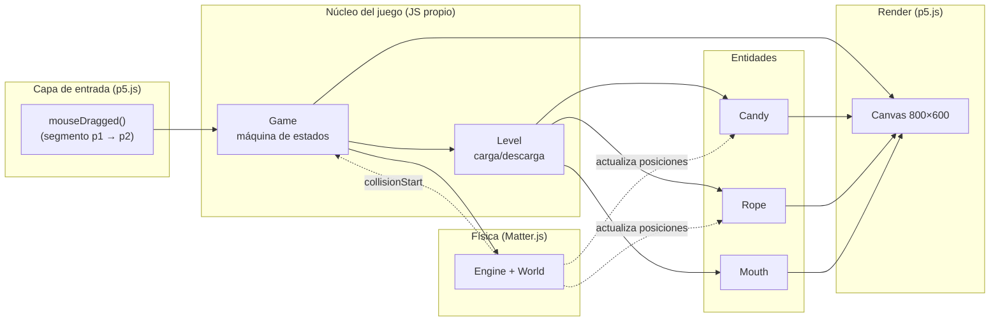
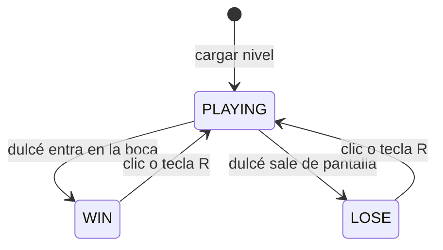
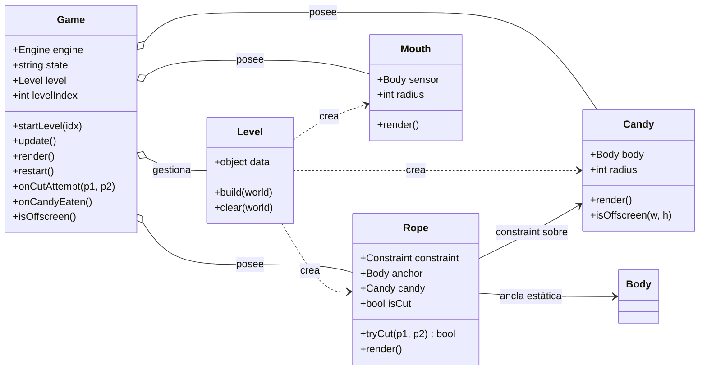
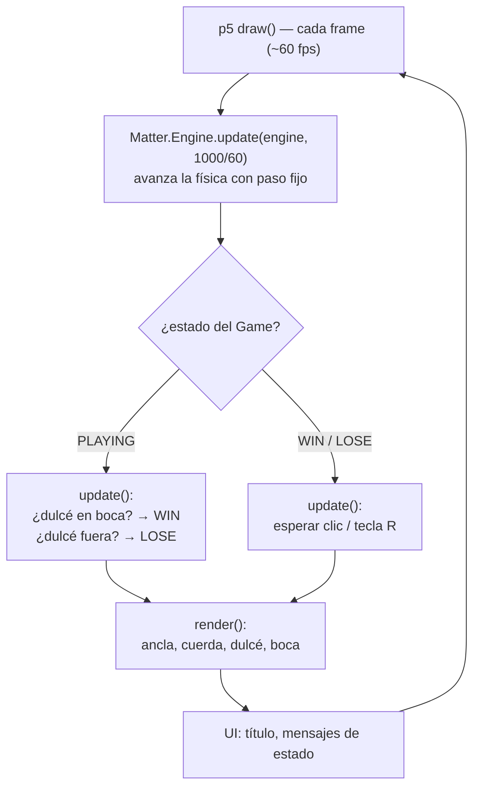

# Arquitectura MVP — Recreación de *Cut the Rope*

> Proyecto: Visual Computing 2026-II
> Stack: **JavaScript + p5.js (render/input) + Matter.js (física)** — 100% estático, sin build, listo para GitHub Pages.

---

## Tabla de contenidos

1. [Resumen del sistema](#1-resumen-del-sistema)
2. [Alcance de la MVP](#2-alcance-de-la-mvp)
3. [Estados del juego](#3-estados-del-juego)
4. [Arquitectura por componente](#4-arquitectura-por-componente)
5. [Estructura de archivos](#5-estructura-de-archivos)
6. [Game loop](#6-game-loop)
7. [Fuera de alcance de la MVP](#7-fuera-de-alcance-de-la-mvp)

---

## 1. Resumen del sistema

El juego se resuelve con **tres responsabilidades bien separadas**:

| Capa | Tecnología | Responsabilidad |
|---|---|---|
| **Física** | Matter.js | Gravedad, cuerpo del dulcé, constraint (cuerda), colisiones (boca como sensor) |
| **Render + Input** | p5.js | Dibujar escena, detectar arrastre del ratón, game loop |
| **Lógica de juego** | JS propio | Máquina de estados (jugando/ganado/perdido), detección de corte, reinicio |

Diagrama de alto nivel:



**Idea central:** p5.js **no** usa el renderizador de Matter (`Matter.Render` ni canvas de Matter). Solo usamos `Matter.Engine` para simular, y p5.js dibuja todo a partir de las posiciones de los bodies. Esto da control total del visual y un solo canvas en pantalla.

---

## 2. Alcance de la MVP

### ✅ Dentro (lo mínimo jugable)

1. **Un nivel** (definido por datos, no hardcodeado en la lógica).
2. **Dulcé (candy)**: cuerpo circular que cuelga de la cuerda.
3. **Cuerda**: 1 constraint (línea recta) entre un ancla fija y el dulcé.
4. **Corte**: arrastrar el ratón a través de la cuerda la elimina.
5. **Boca (objetivo)**: círculo sensor; si el dulcé entra → **GANASTE**.
6. **Derrota**: el dulcé sale de la pantalla hacia abajo → **PERDISTE**.
7. **Reinicio** con un clic o la tecla `R` tras ganar o perder.
8. Render básico con formas (círculos + línea).

### ❌ Fuera de la MVP (ver [sección 7](#7-fuera-de-alcance-de-la-mvp))

Escenas, estrellas, múltiples cuerdas, niveles con selector, sonido, touch, etc.

---

## 3. Estados del juego

Máquina de estados mínima de 3 estados:



| Estado | `update()` hace | `render()` hace |
|---|---|---|
| `PLAYING` | Checa colisión dulcé-boca y salida de pantalla | Escena completa |
| `WIN` | Espera input de reinicio | Escena + mensaje "¡Ganaste!" |
| `LOSE` | Espera input de reinicio | Escena + mensaje "Perdiste" |

> Decisión de diseño: **la física sigue corriendo en WIN/LOSE** (el dulcé cae y rueda) — es gratis y se ve bien. Solo la lógica de victoria/derrota se desactiva.

---

## 4. Arquitectura por componente

### Diagrama de clases



### Tabla de responsabilidades

| Clase | Archivo | Responsabilidad | **No hace** |
|---|---|---|---|
| `Game` | `game.js` | Máquina de estados, crea el `Engine`, orquesta update/render, reinicio, recibe eventos de corte y colisión | No dibuja formas, no define niveles |
| `Level` | `level.js` | Traduce datos del nivel en entidades; limpia el mundo al cambiar de nivel | No tiene lógica de gameplay |
| `Candy` | `candy.js` | Su `Body` circular, render, detección de salida de pantalla | No decide cuándo se gana |
| `Rope` | `rope.js` | Su `Constraint` + ancla, `tryCut()` (intersección), render de la línea | No lee el ratón directamente |
| `Mouth` | `mouth.js` | Su `Body` sensor, render | No detecta colisiones (eso lo hace Matter) |
| datos | `levels.js` | Constante `LEVELS` con posiciones (sin lógica) | — |
| `main.js` | raíz | Adaptador p5: `setup()`/`draw()`, conecta input a `Game` | Cero lógica de juego |

**Regla de oro de la MVP:** cada archivo es pequeño y con un solo trabajo. `main.js` debería caber en ~40 líneas.

---

## 5. Estructura de archivos

```
src/
├── index.html
├── libraries/
│   ├── p5.min.js
│   └── matter.min.js
├── main.js
├── levels.js         ← 1. datos de niveles (const LEVELS)
├── candy.js          ← 2. clase Candy
├── rope.js           ← 3. clase Rope
├── mouth.js          ← 4. clase Mouth
├── level.js          ← 5. clase Level (depende de 2-4)
└── game.js           ← 6. clase Game (depende de 5)
```

---

## 6. Game loop



---

## 7. Fuera de alcance de la MVP

Dejar explícito lo que **no** se hace ahora (y cómo la arquitectura lo permite después):

| Feature | Por qué no | Cómo encajaría después |
|---|---|---|
| Múltiples niveles con selector | La MVP ya soporta N niveles vía `LEVELS` | UI de menú + `levelIndex` |
| Cuerdas segmentadas / varias cuerdas | Un solo constraint es suficiente para jugar | `Rope` con array de constraints; `tryCut` itera segmentos |
| Estrellas / puntaje | Añade estado extra | Nuevos bodies sensor + contador en `Game` |
| Tijera visual que sigue al ratón | Cosmético | Dibujar en `render()` usando `mouseX/mouseY` |
| Aire, veneno, nudos deslizantes | Mecánicas nuevas | Nuevos tipos de body/eventos |
| Sonido y animaciones | Cosmético | `p5.sound` + sprites |
| Soporte táctil (móvil) | `mouseDragged` no cubre touch | `touchStarted/touchMoved` mapeados al mismo `onCutAttempt` |
| Partículas al cortar | Cosmético | Array de partículas en `Rope` |

---