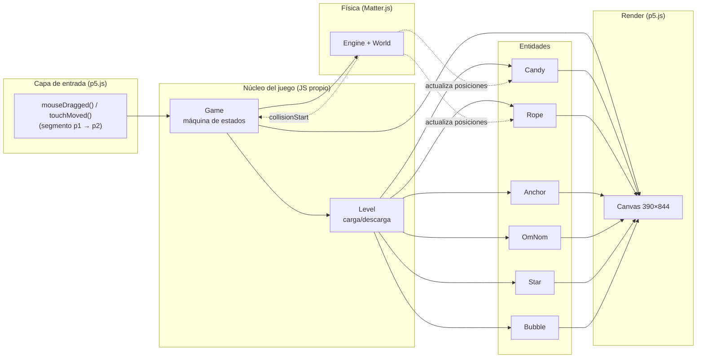
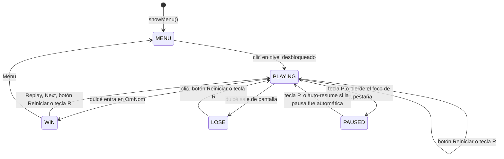
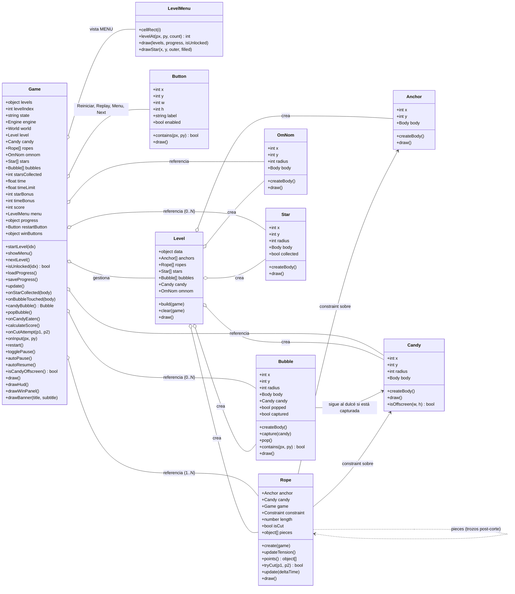
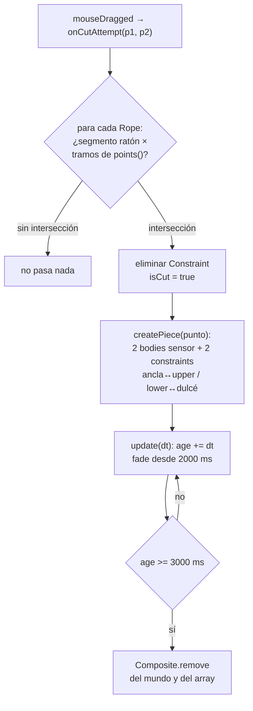
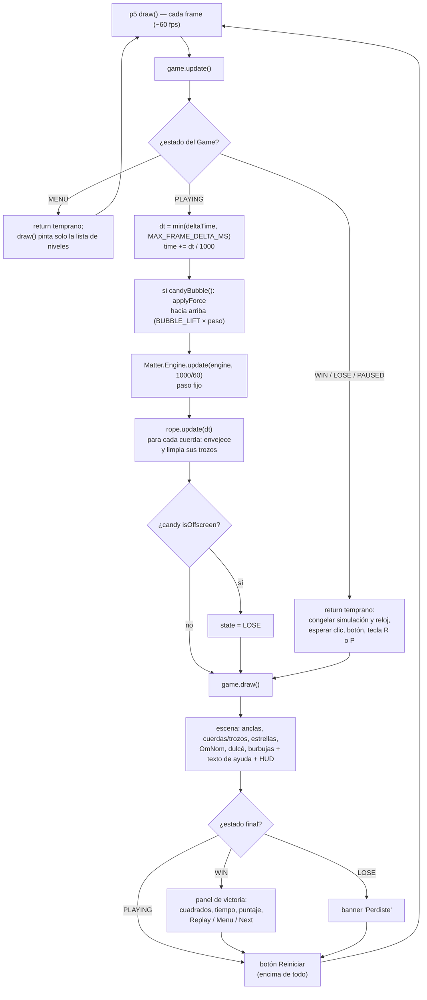

# Arquitectura MVP — Recreación de *Cut the Rope*

> Proyecto: Visual Computing 2026-II
> Stack: **JavaScript + p5.js (render/input) + Matter.js (física)** — 100% estático, sin build, listo para GitHub Pages.
> Estado: **MVP completada**. Las secciones 1–7 describen lo implementado; la [sección 8](#8-hoja-de-ruta-post-mvp) es la hoja de ruta hacia un producto "casi terminal".

---

## Tabla de contenidos

1. [Resumen del sistema](#1-resumen-del-sistema)
2. [Alcance de la MVP](#2-alcance-de-la-mvp)
3. [Estados del juego](#3-estados-del-juego)
4. [Arquitectura por componente](#4-arquitectura-por-componente)
5. [Corte de cuerda y trozos](#5-corte-de-cuerda-y-trozos)
6. [Estructura de archivos](#6-estructura-de-archivos)
7. [Game loop](#7-game-loop)
8. [Hoja de ruta post-MVP](#8-hoja-de-ruta-post-mvp)

---

## 1. Resumen del sistema

El juego se resuelve con **tres responsabilidades bien separadas**:

| Capa | Tecnología | Responsabilidad |
|---|---|---|
| **Física** | Matter.js | Gravedad, cuerpo del dulcé, constraints (cuerdas y trozos), colisiones (OmNom y estrellas como sensores) |
| **Render + Input** | p5.js | Dibujar la escena, detectar arrastre del ratón, game loop |
| **Lógica de juego** | JS propio | Máquina de estados (jugando/ganado/perdido), detección de corte, estrellas, reloj y puntaje, reinicio |

Diagrama de alto nivel:



**Idea central:** p5.js **no** usa el renderizador de Matter (`Matter.Render` ni canvas de Matter). Solo usamos `Matter.Engine` para simular, y p5.js dibuja todo a partir de las posiciones de los bodies. Esto da control total del visual y un solo canvas en pantalla.

---

## 2. Alcance de la MVP

### ✅ Dentro (lo mínimo jugable)

1. **Niveles definidos por datos** (`LEVELS` en [`levels.js`](../src/data/levels.js)): 4 niveles, cada uno con posiciones de dulcé, anclas y OmNom, y opcionalmente `stars` (lista de posiciones; la cantidad es `stars.length`), `bubbles` (lista de posiciones) y `time` (segundos de referencia para el bonus, 30 si falta). El nivel 1 es el básico: una cuerda y 3 estrellas en línea debajo del dulce. El nivel 4 presenta la burbuja: cuerda, burbuja debajo del dulce, 3 estrellas arriba y OmNom abajo.
2. **Dulcé (candy)**: cuerpo circular (`restitution: 0.3`, `frictionAir: 0.01`, `friction: 0.05`) que cuelga de las cuerdas.
3. **Cuerdas**: cada ancla fija (`anchors` en los datos del nivel) crea su propio constraint hacia el dulcé; el dulcé solo cae cuando se cortan todas. Cada ancla acepta un `length` opcional en píxeles: si es mayor que la distancia ancla-dulcé la cuerda nace con holgura, se dibuja colgando en curva y solo tira cuando se estira; si falta (o es menor), nace tensa.
4. **Anclas**: bodies estáticos y sensor (`Anchor`), renderizadas como dos círculos concéntricos.
5. **Corte**: arrastrar el ratón a través de la cuerda la elimina; la cuerda se convierte en **dos trozos físicos** que cuelgan y se desvanecen (ver [sección 5](#5-corte-de-cuerda-y-trozos)).
6. **OmNom (objetivo)**: círculo estático sensor; si el dulcé lo toca → **GANASTE** (evento `collisionStart` con labels `candy`/`omnom`).
7. **Derrota**: el dulcé sale de la pantalla por **cualquier borde** (margen = su radio) → **PERDISTE**.
8. **Reinicio**: botón **Reiniciar** (esquina inferior izquierda del canvas, con el texto de ayuda a su derecha) o tecla `R` en cualquier momento dentro de un nivel; tras perder, también un clic en cualquier parte.
9. **Estrellas**: bodies estáticos sensor (`Star`, label `star`); el dulcé las recoge al tocarlas (evento `collisionStart` con labels `candy`/`star`) y desaparecen del mundo.
10. **Tiempo y puntaje**: el reloj cuenta los segundos en `PLAYING`. Al ganar, `calculateScore()` aplica la regla del juego original: 1000 puntos por estrella + bonus de tiempo = `max(0, time del nivel − segundos) × 100`, redondeado a decenas. No hay límite: si te pasas, el bonus es 0.
11. **Menú de niveles** (`LevelMenu` en [`level-menu.js`](../src/ui/level-menu.js)): el juego arranca aquí. Cada nivel es un cuadrado con su número y 3 estrellas debajo, llenas según el mejor resultado. Solo el nivel 1 está abierto al inicio; ganar un nivel desbloquea el siguiente. El progreso (`completed` y `bestStars` por nivel) se persiste en `localStorage` (key `ctr_progress_v1`): el constructor de `Game` lo carga con `loadProgress()` y `onCandyEaten()` lo guarda con `saveProgress()` al ganar, así sobrevive a recargas.
12. **Botones de victoria**: Replay (repite el nivel), Menu (vuelve a la lista) y Next (siguiente nivel; apagado en el último). En la victoria un clic fuera de los botones no hace nada.
13. **Burbujas** (`Bubble` en [`bubble.js`](../src/entities/bubble.js), label `bubble`): sensor estático dibujado como círculo azul semitransparente. Cuando el dulcé la toca, la burbuja queda pegada al dulcé (su sensor sale del mundo) y el dulcé sube despacio: `Game` aplica una fuerza hacia arriba de `BUBBLE_LIFT` (1.5) veces su peso y sube su `frictionAir` a `BUBBLE_FRICTION_AIR` (0.05). Un clic sobre el dulcé la revienta y el dulcé vuelve a su gravedad y fricción normales. Si nadie la revienta, el dulcé sale por arriba y se pierde.
14. Render básico con formas (círculos + líneas), HUD (estrellas y tiempo), pantalla de victoria (un cuadrado por estrella, tiempo, puntaje y botones), banner de derrota, botón de reinicio y texto de ayuda. Los botones son instancias de `Button` ([`button.js`](../src/ui/button.js)).
15. **Soporte táctil (móvil)**: [`main.js`](../src/core/main.js) define `touchStarted`/`touchMoved`/`touchEnded`, mapeados al mismo `onInput`/`onCutAttempt` que el ratón. `touchMoved` arma el segmento de corte con un `touchPrev` propio (p5 no actualiza `pmouseX` entre eventos de `touchmove`), y un guard temporal (`TOUCH_MOUSE_GUARD_MS = 500`) ignora los eventos de ratón sintéticos que el navegador dispara tras un toque, evitando input duplicado. El CSS del canvas usa `touch-action: none` para bloquear scroll/zoom durante el juego.

### ❌ Quedó fuera de la MVP (ver [sección 8](#8-hoja-de-ruta-post-mvp))

Sonido, mecánicas nuevas (viento, OmNom móvil), etc. — ahora priorizado en la hoja de ruta.

---

## 3. Estados del juego

Máquina de estados de 5 estados (constante `STATE` en [`game.js`](../src/core/game.js)):



| Estado | `update()` hace | `draw()` hace |
|---|---|---|
| `MENU` | Nada (return temprano; el mundo está vacío) | Lista de niveles (`LevelMenu.draw`): cuadrado con número, gris si está bloqueado, y 3 estrellas según `bestStars` |
| `PLAYING` | Suma `time`, aplica la fuerza de la burbuja si el dulcé está en una, avanza `Matter.Engine.update(engine, 1000/60)`, actualiza trozos de cuerda, evalúa salida de pantalla | Escena completa + HUD (estrellas y tiempo) + texto de ayuda + botón Reiniciar |
| `PAUSED` | **Congela la simulación y el reloj** igual que `WIN`/`LOSE` (return temprano) y espera la tecla `P` (si la pausa fue automática al perder el foco, se reanuda sola al recuperar el foco) | Escena congelada + banner "Pausa" ("tecla P para continuar") + botón Reiniciar |
| `WIN` | **Congela la simulación y el reloj** (return temprano; no llama a `Engine.update`) y espera input de reinicio | Escena congelada + panel de victoria (`drawWinPanel`: un cuadrado por estrella del nivel, lleno si se recogió; tiempo; puntos de estrellas y bonus; puntaje; botones Replay, Menu y Next) + botón Reiniciar |
| `LOSE` | **Congela la simulación y el reloj** igual que `WIN` y espera input de reinicio | Escena congelada + banner "Perdiste" + botón Reiniciar |

> Decisión de diseño: **al terminar el nivel (ganar o perder), la simulación se congela** — la escena se queda en el último frame hasta reiniciar. Todo reinicio termina en `restart()` → `startLevel(levelIndex)`, que limpia el mundo y reconstruye el nivel completo:
> - `onInput(px, py)` decide según el estado:
>   - `MENU`: `menu.levelAt()` y, si `isUnlocked(idx)`, `startLevel(idx)`;
>   - en un nivel, el botón Reiniciar siempre reinicia;
>   - `PLAYING`: si el dulcé está en una burbuja y el clic cae dentro de ella, `popBubble()` la revienta;
>   - `WIN`: Replay → `restart()`, Menu → `showMenu()`, Next → `nextLevel()`; fuera de los botones no pasa nada;
>   - `LOSE`: un clic en cualquier parte reinicia.
> - La tecla `R` llama a `restart()` directamente, salvo en `MENU`.
> - La tecla `P` llama a `togglePause()`: alterna `PLAYING` ↔ `PAUSED` (en `MENU`, `WIN` y `LOSE` no hace nada). Pausar congela escena y reloj; al reanudar, el `deltaTime` del frame de transición no cuenta, porque el reloj solo avanza en `PLAYING`.
> - La pestaña pierde el foco (`document.visibilitychange` en `main.js`): `autoPause()` congela la escena (bandera `autoPaused`) y, al recuperar el foco, `autoResume()` reanuda sola **solo si la pausa fue automática**; una pausa manual con `P` no se reanuda sola. `update()` acota el `deltaTime` a `MAX_FRAME_DELTA_MS` (100 ms), así el primer frame tras volver a la pestaña no salta el reloj ni la vida de los trozos.
> - Al ganar, `onCandyEaten()` marca el nivel como completado (desbloquea el siguiente), guarda el máximo de estrellas logradas y persiste el progreso en `localStorage`; el constructor de `Game` lo carga al arrancar (`loadProgress()`).

---

## 4. Arquitectura por componente

### Diagrama de clases



### Tabla de responsabilidades

| Clase / archivo | Responsabilidad | **No hace** |
|---|---|---|
| `Game` ([`game.js`](../src/core/game.js)) | Máquina de estados, crea el `Engine` (gravedad `y = 1`), orquesta `update()`/`draw()`, escucha `collisionStart` (dulcé con OmNom, estrellas y burbujas), cuenta estrellas, captura y revienta burbujas (fuerza de subida y `frictionAir`: `BUBBLE_LIFT`, `BUBBLE_FRICTION_AIR`, `CANDY_FRICTION_AIR`), reloj y puntaje (`STAR_POINTS`, `TIME_BONUS_PER_SECOND`, `DEFAULT_LEVEL_TIME`), pausa (`togglePause`; estado `PAUSED` congela simulación y reloj) y pausa automática al perder el foco (`autoPause`/`autoResume` con bandera `autoPaused`; `update()` acota el `deltaTime` a `MAX_FRAME_DELTA_MS`), reinicio, navegación entre niveles (`showMenu`, `nextLevel`, `isUnlocked`), apertura/cierre de la boca según la proximidad del dulce (`mouthOpenRadius`/`mouthCloseRadius`), victoria cuando el dulce ya está dentro de la boca (`eatRadius`), eliminación del dulce y desvanecimiento gradual de sus cuerdas al comer y retardo del panel de victoria (`winRevealDelay`) para apreciar la animación, progreso persistente en `localStorage` (`loadProgress`/`saveProgress`; `completed`, `bestStars`), HUD, panel de victoria, banners; reparte los clics según el estado | No dibuja las entidades ni la lista de niveles, no define niveles |
| `LevelMenu` ([`level-menu.js`](../src/ui/level-menu.js)) | Disposición de la lista (cuadrícula de 3 columnas, `LEVEL_MENU`), `levelAt()` para saber qué cuadrado se clicó, dibujo de cuadrados con número y estrellas (`drawStar()` propio, llena o solo borde) | No decide qué nivel está desbloqueado ni guarda progreso (lo recibe de `Game`) |
| `Button` ([`button.js`](../src/ui/button.js)) | Rectángulo con texto, `contains()` para el clic, `draw()` con hover y estado apagado (`enabled = false`) | No sabe qué hace al pulsarse (lo decide `Game`) |
| `Level` ([`level.js`](../src/core/level.js)) | Traduce los datos del nivel en entidades (dulcé, OmNom, anclas + cuerdas, estrellas, burbujas); limpia el mundo (`Composite.clear`) al cambiar de nivel; dibuja la imagen de fondo del nivel cubriendo el canvas sin deformarla; delega el `draw()` (el dulce siempre se dibuja delante de OmNom, ya que el juego no modela profundidad) | No tiene lógica de gameplay |
| `Anchor` ([`anchor.js`](../src/entities/anchor.js)) | Su `Body` circular estático + sensor (radio 8), render | No se mueve, no decide nada |
| `Candy` ([`candy.js`](../src/entities/candy.js)) | Su `Body` circular con label `candy`, render, `isOffscreen()` (los 4 bordes, margen = radio) y bandera `eaten` para ocultarlo tras ser comido | No decide cuándo se gana |
| `Rope` ([`rope.js`](../src/entities/rope.js)) | Su `Constraint` ancla→dulcé con largo opcional (`length`); tensión de un solo lado con `updateTension()` (`stiffness` 1 si está estirada, 0 si tiene holgura); forma con `points()` (recta o curva colgante); `tryCut()` sobre los tramos de esa forma; creación y ciclo de vida de los trozos post-corte; `startEatenFade()`/`eatenAlpha()` desvanecen gradualmente la cuerda y sus trozos al comerse el dulce, y `remove()` los quita del mundo al terminar el fundido; render de cuerda/trozos | No lee el ratón directamente |
| `SpriteAnimator` ([`animation.js`](../src/core/animation.js)) | Carga atlas, reproduce estados y secuencias, avanza frames y renderiza rectángulos fuente con sus dimensiones; usa `pivotX`/`pivotY` locales del frame para mantener al personaje alineado | No conoce entidades, física ni reglas de gameplay |
| animaciones ([`animations.js`](../src/data/animations.js)) | Define atlas y estados reutilizables de OmNom con rangos de frames; `prepareOmNomAnimations()` deriva los rectángulos de origen, el ancho de referencia y los pivotes desde `char_estados.json` y `char_lose.json` | No carga imágenes ni JSON, ni dibuja |
| `OmNom` ([`omnom.js`](../src/entities/omnom.js)) | Su `Body` circular estático + sensor con label `omnom`; delega animación y render a `SpriteAnimator`; mantiene `mouthOpen` cuando el dulce está cerca, cierra con `mouthClose → idle` al alejarse y con `mouthClose → chew` al comer; reproduce `fail` al perder | No detecta colisiones, no calcula recortes ni decide el resultado del nivel |
| `Star` ([`star.js`](../src/entities/star.js)) | Su `Body` circular estático + sensor (radio 20) con label `star`, bandera `collected`, render de estrella de 5 puntas dentro de `draw()` (no se dibuja si está recogida) | No suma puntos ni se quita del mundo (eso lo hace `Game`) |
| `Bubble` ([`bubble.js`](../src/entities/bubble.js)) | Su `Body` circular estático + sensor (`BUBBLE_RADIUS` 30) con label `bubble`; estado `captured` (tiene dulcé y no está reventada) y `popped`; `contains()` para el clic sobre el dulcé; render de círculo azul semitransparente, en su sitio o alrededor del dulcé | No aplica fuerzas ni se quita del mundo (eso lo hace `Game`) |
| datos ([`levels.js`](../src/data/levels.js)) | Constante `LEVELS`: array de 4 niveles con `name`, `candy`, `anchors` (cada una con `length` opcional), `omnom` y opcionalmente `time`, `stars`, `bubbles` y `background` (ruta de la imagen de fondo, cargada en `LEVEL_BACKGROUNDS`) (solo datos) | Sin lógica |
| [`main.js`](../src/core/main.js) | Adaptador p5: `preload()` carga los JSON de los atlas, `setup()` prepara las animaciones, crea el `Game` y abre el menú (`showMenu()`), `draw()`, conecta `mouseDragged`/`touchMoved` → `onCutAttempt`, `mousePressed`/`touchStarted` → `onInput(mouseX, mouseY)`, la tecla `R` → `restart()` y la tecla `P` → `togglePause()` (ambas salvo en `MENU`), filtra los eventos de ratón sintéticos posteriores a un toque (`TOUCH_MOUSE_GUARD_MS`) y registra `document.visibilitychange` → `game.autoPause()` / `game.autoResume()` | Cero lógica de juego |

**Regla de oro de la MVP:** cada archivo es pequeño y con un solo trabajo. `main.js` cabe en ~30 líneas.

### Pivotes de los sprites

Los JSON de TexturePacker no conservan la alineación original de cada recorte (`trimmed: false`, `spriteSourceSize` en `0,0`), así que centrar cada frame por su bounding box hace que el personaje se desplace al animarse. La herramienta [`tools/sprite_pivots.py`](../tools/sprite_pivots.py) analiza el canal alfa de la imagen, ancla los pies de cada frame y escribe `pivotX`/`pivotY` (coordenadas locales del recorte) dentro del `frame` del JSON:

```bash
python3 tools/sprite_pivots.py --image src/img/char_estados.png --atlas src/img/char_estados.json
python3 tools/sprite_pivots.py --image src/img/char_lose.png --atlas src/img/char_lose.json
```

El modo por defecto es `hybrid`: fija los pies y refina el eje X por registro de siluetas. `--mode bottom` usa solo el ancla por pies y `--mode register` hace registro puro. Con `--debug ruta.png` genera una hoja de verificación. Requiere `Pillow` y `numpy`.

---

## 5. Corte de cuerda y trozos

El corte es el comportamiento más "físico" de la MVP y vive enteramente en [`rope.js`](../src/entities/rope.js):

1. **Detección** — `tryCut(p1, p2)` recibe el segmento del arrastre del ratón y lo interseca con cada tramo de `points()` usando `segmentIntersection()` (producto cruzado; devuelve el punto solo si la intersección cae dentro de ambos segmentos). Si la cuerda está tensa, `points()` es solo el segmento ancla→dulcé; si tiene holgura, son 16 tramos de una Bézier cuadrática cuya caída central es `s = sqrt(3·d·(L − d) / 8)`. Si ya está cortada o no hay intersección, no hace nada.
2. **Remoción** — al cortar, el `Constraint` original se elimina del mundo y `isCut = true`.
3. **Trozos** — `createPiece(point)` construye dos "pedazos" de cuerda alrededor del punto de corte:
   - `upperBody`: body circular sensor (radio 5) ligado a la **ancla** con un constraint (`stiffness: 1`, longitud = distancia ancla→punto).
   - `lowerBody`: body circular sensor (radio 5) ligado al **dulcé** con un constraint (`stiffness: 1`, longitud = distancia punto→dulcé).
   - Los dos bodies son `isSensor: true`, así no interfieren con otras colisiones.
4. **Vida y fade** — cada trozo lleva un `age` que avanza en `Rope.update(deltaTime)`:
   - `ROPE_PIECE_FADE_START = 2000` ms: empieza a desvanecerse (alpha lineal en `pieceAlpha()`).
   - `ROPE_PIECE_LIFETIME = 3000` ms: los 4 objetos (2 bodies + 2 constraints) se eliminan del mundo.
   - Como los trozos son bodies reales, **cuelgan físicamente** tras el corte (el trozo superior pende de la ancla, el inferior sigue al dulcé).
5. **Render** — `Rope.draw()` dibuja la cuerda entera con `points()` (recta o curva) si vive; si está cortada, dibuja las dos mitades (ancla→`upperBody` y `lowerBody`→dulcé) con el alpha calculado según la edad.



---

## 6. Estructura de archivos

El orden de carga importa: cada archivo depende solo de los anteriores (las clases de entidad antes que `Level`, y `Level` antes que `Game`).

```
src/
├── index.html           ← carga los scripts en el orden correcto
├── libraries/
│   ├── p5.min.js
│   └── matter.min.js
├── levels.js            ← 1. datos de niveles (const LEVELS, 4 niveles)
├── candy.js             ← 2. clase Candy
├── anchor.js            ← 3. clase Anchor
├── rope.js              ← 4. clase Rope + helpers de intersección
├── omnom.js             ← 5. clase OmNom
├── star.js              ← 6. clase Star
├── bubble.js            ← 7. clase Bubble
├── button.js            ← 8. clase Button (botones de canvas)
├── level-menu.js        ← 9. clase LevelMenu (con su propio dibujo de estrella)
├── level.js             ← 10. clase Level (depende de 2-7)
├── game.js              ← 11. clase Game + STATE + reglas de puntaje y burbuja (depende de 8-10)
└── main.js              ← 12. adaptador p5 (setup/draw/input)
```

---

## 7. Game loop



Dentro de un nivel, `draw()` termina siempre con `restartButton.draw()`, después del panel o banner, para que el botón quede visible y clicable también sobre "¡Ganaste!" y "Perdiste".

**Eventos de Matter** (fuera del loop explícito): el `collisionStart` registrado en el constructor de `Game` compara los `label` de cada par de bodies:
- `candy` + `star` llama a `onStarCollected(body)`: marca la estrella como recogida, la quita del mundo y suma `starsCollected` (solo en `PLAYING`).
- `candy` + `bubble` llama a `onBubbleTouched(body)`: si el dulcé no está ya en otra burbuja, la captura, quita su sensor del mundo y sube el `frictionAir` del dulcé (solo en `PLAYING`).
- `candy` + `omnom` llama a `onCandyEaten()`, que pasa a `WIN` (solo si estaba en `PLAYING`) y calcula el puntaje con `calculateScore()`.

Las estrellas de un mismo paso se procesan antes que OmNom, así una estrella tocada en el mismo frame en que el dulcé llega a la boca sí cuenta.

---

## 8. Hoja de ruta post-MVP

Con la MVP completada, esta sección reemplaza la anterior lista "fuera de alcance" por un plan priorizado para llegar a un **producto básico pero casi terminal**. Cada feature encaja en el patrón existente del proyecto — datos en [`levels.js`](../src/data/levels.js), entidades como bodies con `label`, decisiones en [`Game`](../src/core/game.js), input en [`main.js`](../src/core/main.js) — así que no hay refactor previo que hacer.

### 8.1 Prioridad 0 — Producto sólido (bajo esfuerzo, alto impacto)

| # | Feature | Brecha actual | Dónde encaja |
|---|---|---|---|
| 1✅ |  **Persistir progreso en `localStorage`** | Resuelto: el constructor de [`Game`](../src/core/game.js) carga el progreso con `loadProgress()` (key `ctr_progress_v1`, tolerando datos corruptos o faltantes) y `onCandyEaten()` lo guarda con `saveProgress()` al ganar | — |
| 2 | **Sonido** | Cero audio en el proyecto; es lo que más "terminado" hace sentir un juego | Cortes, estrellas, pop de burbuja y victoria/derrota con **Web Audio API** (sin librería nueva; el bloque de scripts de `index.html` no se toca) |
| 3✅ | **Pausa** | Resuelto: nuevo estado `PAUSED` en `STATE` + tecla `P` (`togglePause()` alterna `PLAYING` ↔ `PAUSED`); el patrón de early-return de `update()` congela simulación y reloj, y `draw()` muestra un banner "Pausa" | — |

### 8.2 Prioridad 1 — Profundidad de juego

| # | Feature | Brecha actual | Cómo encaja |
|---|---|---|---|
| 4 | **Más niveles (8–12)** | Solo 4 en `LEVELS`; la cuadrícula de 3 columnas de `LevelMenu` ya soporta más | Solo datos: agregar objetos a `LEVELS`; el desbloqueo (`isUnlocked`) y el botón `Next` deshabilitado en el último ya los soportan |
| 5 | **Zona de viento** | Mecánica clásica del original ausente | Body rectangular sensor con label `wind` + `applyForce` a los bodies dentro de su rectángulo (mismo patrón que la fuerza de la burbuja en `Game.update()`) |
| 6 | **HUD mejorado** (nivel, objetivo y bonus en vivo) | `drawHud()` solo muestra estrellas y tiempo transcurrido; el jugador no ve el `time` del nivel contra el que se mide el bonus | Mostrar `Nivel N · Objetivo: Xs · Bonus actual: Y` usando la misma fórmula de `calculateScore()` |

### 8.3 Prioridad 2 — Pulido cosmético

| # | Feature | Brecha actual | Notas |
|---|---|---|---|
| 7 | **Partículas** (corte, estrella, pop, victoria) | El feedback visual hoy son solo los trozos físicos de `Rope` | Array cosmético de partículas con vida corta, dentro de `draw()` |
| 8 | **Animación de OmNom y carita del dulcé** | `OmNom.draw()` es un círculo sin cara; `Candy.draw()` es un círculo plano | OmNom que abre la boca cuando el dulcé se acerca y parpadea; todo en `draw()`, cero lógica |
| 9 | **Total de estrellas en el menú** | El encabezado de `LevelMenu.draw()` no muestra progreso global | Sumar `bestStars` en el título: `★ 7/12` |
| 10 | **Canvas responsivo / escalado** | `createCanvas(390, 844)` fijo; en pantallas cortas se corta | `windowResized()` o escalado CSS manteniendo el ratio (los inputs ya están en coordenadas de canvas) |
| 11✅ | **Pausa automática al perder foco** | Resuelto: `setup()` de [`main.js`](../src/core/main.js) registra `document.visibilitychange` y llama a `Game.autoPause()` (al ocultarse) / `Game.autoResume()` (al volver); la pausa automática se reanuda sola al recuperar el foco (la manual con `P` no) y `Game.update()` acota el `deltaTime` a `MAX_FRAME_DELTA_MS` (100 ms) para que el reloj no salte | — |
