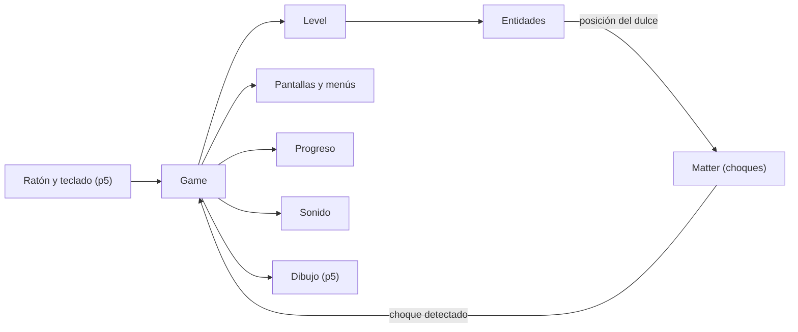
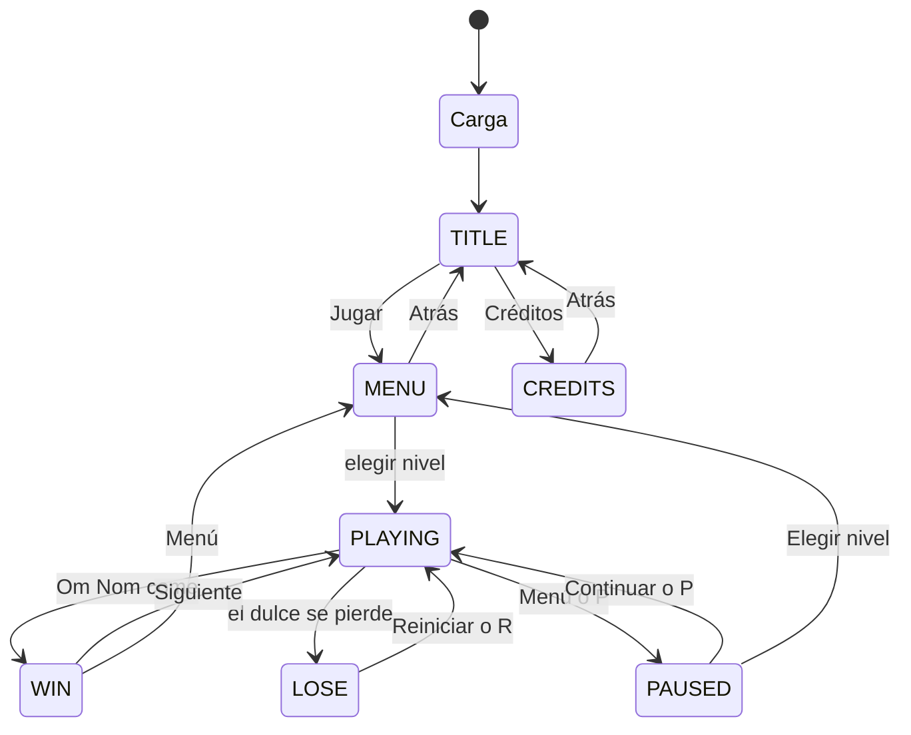

# Arquitectura

Proyecto de Visual Computing 2026-II: una recreación de *Cut the Rope* en el navegador, hecha con JavaScript plano y p5.js. Es un sitio estático, sin build, publicado en GitHub Pages.

Documentos relacionados: [física y cuerdas](fisica-y-cuerdas.md) · [niveles](niveles.md) · [assets](assets.md).

---

## 1. Resumen

Cada librería hace una sola cosa:

| Pieza | Qué hace |
|---|---|
| **p5.js** | Dibuja en un canvas de 1920×1440 que se escala a la ventana y lee el ratón y el teclado |
| **Verlet** ([`verlet.js`](../src/core/verlet.js)) | Mueve el dulce y las cuerdas. Se usa en vez de Matter porque una cuerda se estira, se balancea y, al cortarla, cada trozo sigue cayendo, y con los cuerpos rígidos de Matter solo se podía imitar. Es lo que hace el juego original, así el dulce se mueve igual que en sus mapas |
| **Matter.js** | Solo avisa cuando el dulce toca algo (Om Nom, una burbuja, unas púas) |
| **Lógica propia** | Estados, reloj, puntaje, progreso y sonido |

Más detalle en [fisica-y-cuerdas.md](fisica-y-cuerdas.md).



[`main.js`](../src/core/main.js) es solo un adaptador: pasa la entrada a `Game`, escala el canvas y pausa el juego cuando cambias de pestaña. Toda la lógica vive en `Game`.

---

## 2. Pantallas y estados



| Estado | Qué se ve |
|---|---|
| `TITLE` | Logo y botones Jugar y Créditos |
| `CREDITS` | Datos del curso y nombres de los estudiantes |
| `MENU` | Cuadrícula de niveles con candados y estrellas |
| `PLAYING` | El nivel con su HUD (estrellas, Reiniciar, Menú) |
| `PAUSED` | El nivel congelado con el menú de pausa |
| `WIN` | Panel con estrellas, puntaje y botones Repetir, Siguiente y Menú |
| `LOSE` | Cartel "¡Oh, no!" |

Solo en `PLAYING` avanzan la física y el reloj; en cualquier otro estado todo queda congelado. Reiniciar siempre reconstruye el nivel desde cero. Si cambias de pestaña a mitad de un nivel, el juego se pausa solo y se reanuda al volver (una pausa manual no).

---

## 3. Piezas del código

| Archivo | Para qué sirve |
|---|---|
| [`core/main.js`](../src/core/main.js) | Conecta p5 con `Game` y muestra la pantalla de carga |
| [`core/game.js`](../src/core/game.js) | Logica del juego: estados, reloj, puntaje, pausa y reacción a los choques |
| [`core/level.js`](../src/core/level.js) | Convierte los datos de un nivel en objetos y los dibuja |
| [`core/camera.js`](../src/core/camera.js) | Cámara vertical (solo el nivel 15) |
| [`core/verlet.js`](../src/core/verlet.js) | Los puntos que se mueven por Verlet |
| [`core/progress.js`](../src/core/progress.js) | Guarda estrellas, puntajes y niveles desbloqueados en el navegador |
| [`core/rules.js`](../src/core/rules.js) | Cálculo del puntaje |
| [`core/audio.js`](../src/core/audio.js) | Música y efectos |
| [`entities/`](../src/entities/) | Los objetos del nivel: cada uno sabe dibujarse, pero no decide nada del juego |
| [`ui/`](../src/ui/) | Menús, HUD, botones, tutoriales y pantalla de carga |
| [`data/`](../src/data/) | Constantes, niveles, textos y créditos |

Objetos del nivel:

| Objeto | Qué es |
|---|---|
| `Candy` | El dulce; se rompe con las púas |
| `Rope` | Una cuerda: se puede cortar y sus trozos siguen cayendo |
| `Anchor` | Gancho donde empieza una cuerda |
| `AutoAnchor` | Gancho que crea su cuerda cuando el dulce se acerca |
| `OmNom` | El monstruo que hay que alimentar |
| `Star` | Estrella coleccionable |
| `Bubble` | Burbuja que sube al dulce; se revienta con un clic |
| `Spikes` | Púas, quietas o en movimiento |

Para añadir una mecánica nueva: crea el objeto en `entities/`, constrúyelo en `Level.build` y haz que `Game` reaccione cuando el dulce lo toque.

---

## 4. Qué pasa en cada frame

Mientras se juega, `Game` repite esto 60 veces por segundo:

1. Avanza el reloj y mueve las púas y estrellas que se desplazan.
2. Mueve las cuerdas y luego el dulce.
3. Aplica el empuje de la burbuja, si el dulce está dentro de una.
4. Comprueba si el dulce tocó alguna estrella.
5. Pregunta a Matter si hubo choques.
6. Reacciona: el dulce se atrapa en una burbuja, se rompe en unas púas o llega a Om Nom (ganas).
7. Si el dulce salió del mapa, pierdes.
8. Dibuja todo.

---

## 5. Controles

Solo ratón y teclado.

| Entrada | Efecto |
|---|---|
| Arrastrar | Corta una cuerda (como mucho una por arrastre) |
| Clic | Botones, niveles y burbujas; en `LOSE`, reinicia |
| `R` | Reinicia el nivel |
| `P` o `Escape` | Pausa o reanuda |
| `Enter` | En el título, abre el menú de niveles |
| `Escape` | En el menú de niveles y los créditos, vuelve al título |

---

## 6. Progreso y puntaje

- El progreso (estrellas, mejores puntajes y niveles desbloqueados) se guarda en el navegador. Ganar desbloquea el siguiente nivel; "Saltar nivel" en la pausa también.
- El puntaje es `1000 × estrellas` más `100` por cada segundo que sobre de 30.

---

## 7. Estructura de carpetas

```
src/
├── index.html
├── libraries/   p5 y Matter
├── data/        constantes, niveles, textos y créditos
├── core/        juego, nivel, cámara, progreso, reglas, audio y física
├── entities/    objetos del nivel
├── ui/          menús, HUD, sprites y fuentes
└── assets/      imágenes, sonidos y fuentes
```

El código del proyecto usa **módulos ES**: cada archivo declara sus `export` y los consume con `import`; [`index.html`](../src/index.html) solo carga las librerías (p5, Matter) y un `<script type="module" src="core/main.js">`, y el navegador resuelve la graffa de imports desde ahí. **Un archivo nuevo no hay que registrarlo en ningún lado: solo exportar e importarlo.** p5.js y Matter.js se quedan en modo global (`window.p5`, `window.Matter`); [`core/main.js`](../src/core/main.js) asigna `window.preload/setup/draw/...` para que el modo global de p5 los encuentre, y `Matter` se usa por el nombre global.

---

## 8. Despliegue

Cada push a `main` publica `src/` en GitHub Pages ([`deploy.yml`](../.github/workflows/deploy.yml)). Para deshacer un despliegue, revierte el commit y haz push.
