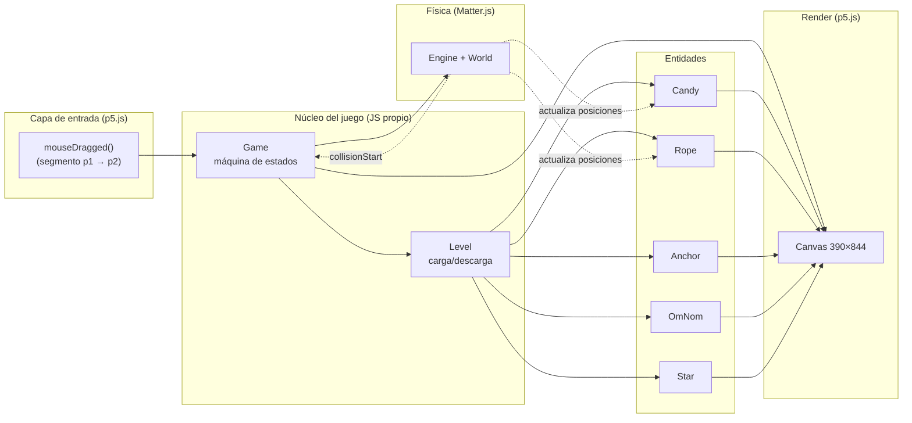
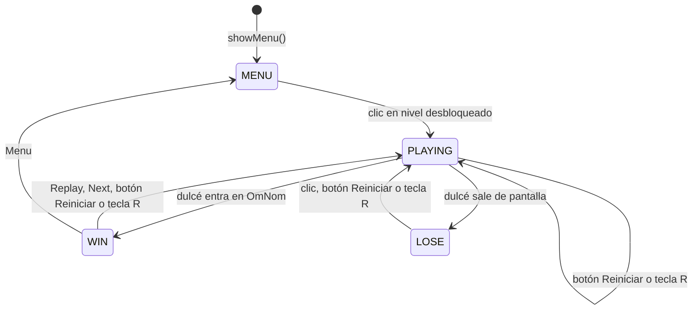
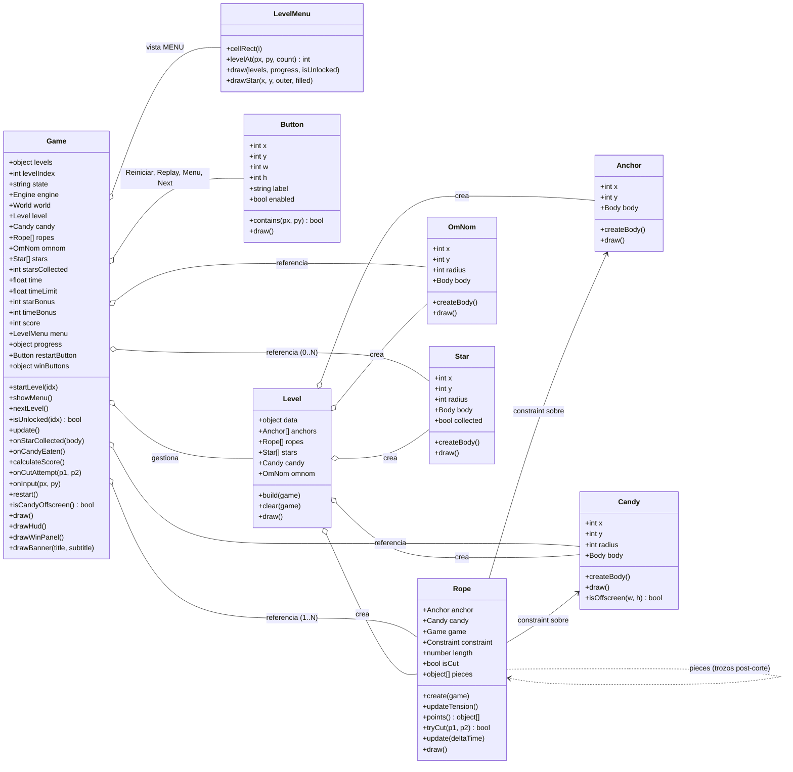
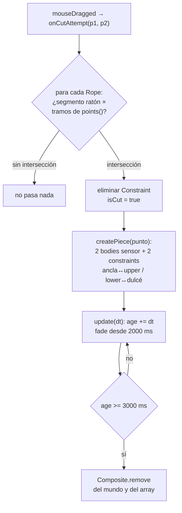
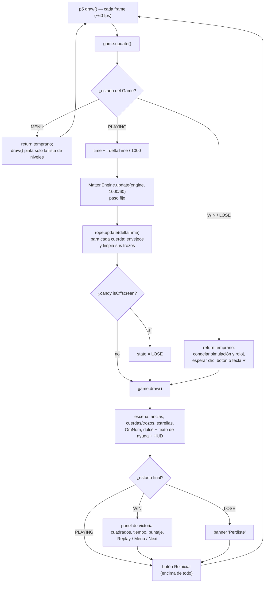

# Arquitectura MVP — Recreación de *Cut the Rope*

> Proyecto: Visual Computing 2026-II
> Stack: **JavaScript + p5.js (render/input) + Matter.js (física)** — 100% estático, sin build, listo para GitHub Pages.

---

## Tabla de contenidos

1. [Resumen del sistema](#1-resumen-del-sistema)
2. [Alcance de la MVP](#2-alcance-de-la-mvp)
3. [Estados del juego](#3-estados-del-juego)
4. [Arquitectura por componente](#4-arquitectura-por-componente)
5. [Corte de cuerda y trozos](#5-corte-de-cuerda-y-trozos)
6. [Estructura de archivos](#6-estructura-de-archivos)
7. [Game loop](#7-game-loop)
8. [Fuera de alcance de la MVP](#8-fuera-de-alcance-de-la-mvp)

---

## 1. Resumen del sistema

El juego se resuelve con **tres responsabilidades bien separadas**:

| Capa | Tecnología | Responsabilidad |
|---|---|---|
| **Física** | Matter.js | Gravedad, cuerpo del dulcé, constraints (cuerdas y trozos), colisiones (OmNom y estrellas como sensores) |
| **Render + Input** | p5.js | Dibujar la escena, detectar arrastre del ratón, game loop |
| **Lógica de juego** | JS propio | Máquina de estados (jugando/ganado/perdido), detección de corte, estrellas, reloj y puntaje, reinicio |

Diagrama de alto nivel:



**Idea central:** p5.js **no** usa el renderizador de Matter (`Matter.Render` ni canvas de Matter). Solo usamos `Matter.Engine` para simular, y p5.js dibuja todo a partir de las posiciones de los bodies. Esto da control total del visual y un solo canvas en pantalla.

---

## 2. Alcance de la MVP

### ✅ Dentro (lo mínimo jugable)

1. **Niveles definidos por datos** (`LEVELS` en [`levels.js`](../src/levels.js)): 3 niveles, cada uno con posiciones de dulcé, anclas y OmNom, y opcionalmente `stars` (lista de posiciones; la cantidad es `stars.length`) y `time` (segundos de referencia para el bonus, 30 si falta). El nivel 1 es el básico: una cuerda y 3 estrellas en línea debajo del dulce.
2. **Dulcé (candy)**: cuerpo circular (`restitution: 0.3`, `frictionAir: 0.01`, `friction: 0.05`) que cuelga de las cuerdas.
3. **Cuerdas**: cada ancla fija (`anchors` en los datos del nivel) crea su propio constraint hacia el dulcé; el dulcé solo cae cuando se cortan todas. Cada ancla acepta un `length` opcional en píxeles: si es mayor que la distancia ancla-dulcé la cuerda nace con holgura, se dibuja colgando en curva y solo tira cuando se estira; si falta (o es menor), nace tensa.
4. **Anclas**: bodies estáticos y sensor (`Anchor`), renderizadas como dos círculos concéntricos.
5. **Corte**: arrastrar el ratón a través de la cuerda la elimina; la cuerda se convierte en **dos trozos físicos** que cuelgan y se desvanecen (ver [sección 5](#5-corte-de-cuerda-y-trozos)).
6. **OmNom (objetivo)**: círculo estático sensor; si el dulcé lo toca → **GANASTE** (evento `collisionStart` con labels `candy`/`omnom`).
7. **Derrota**: el dulcé sale de la pantalla por **cualquier borde** (margen = su radio) → **PERDISTE**.
8. **Reinicio**: botón **Reiniciar** (esquina inferior izquierda del canvas, con el texto de ayuda a su derecha) o tecla `R` en cualquier momento dentro de un nivel; tras perder, también un clic en cualquier parte.
9. **Estrellas**: bodies estáticos sensor (`Star`, label `star`); el dulcé las recoge al tocarlas (evento `collisionStart` con labels `candy`/`star`) y desaparecen del mundo.
10. **Tiempo y puntaje**: el reloj cuenta los segundos en `PLAYING`. Al ganar, `calculateScore()` aplica la regla del juego original: 1000 puntos por estrella + bonus de tiempo = `max(0, time del nivel − segundos) × 100`, redondeado a decenas. No hay límite: si te pasas, el bonus es 0.
11. **Menú de niveles** (`LevelMenu` en [`level-menu.js`](../src/level-menu.js)): el juego arranca aquí. Cada nivel es un cuadrado con su número y 3 estrellas debajo, llenas según el mejor resultado. Solo el nivel 1 está abierto al inicio; ganar un nivel desbloquea el siguiente. El progreso (`completed` y `bestStars` por nivel) vive en memoria y se pierde al recargar.
12. **Botones de victoria**: Replay (repite el nivel), Menu (vuelve a la lista) y Next (siguiente nivel; apagado en el último). En la victoria un clic fuera de los botones no hace nada.
13. Render básico con formas (círculos + líneas), HUD (estrellas y tiempo), pantalla de victoria (un cuadrado por estrella, tiempo, puntaje y botones), banner de derrota, botón de reinicio y texto de ayuda. Los botones son instancias de `Button` ([`button.js`](../src/button.js)).

### ❌ Fuera de la MVP (ver [sección 8](#8-fuera-de-alcance-de-la-mvp))

Guardar el progreso entre sesiones, sonido, touch, etc.

---

## 3. Estados del juego

Máquina de estados de 4 estados (constante `STATE` en [`game.js`](../src/game.js)):



| Estado | `update()` hace | `draw()` hace |
|---|---|---|
| `MENU` | Nada (return temprano; el mundo está vacío) | Lista de niveles (`LevelMenu.draw`): cuadrado con número, gris si está bloqueado, y 3 estrellas según `bestStars` |
| `PLAYING` | Suma `time`, avanza `Matter.Engine.update(engine, 1000/60)`, actualiza trozos de cuerda, evalúa salida de pantalla | Escena completa + HUD (estrellas y tiempo) + texto de ayuda + botón Reiniciar |
| `WIN` | **Congela la simulación y el reloj** (return temprano; no llama a `Engine.update`) y espera input de reinicio | Escena congelada + panel de victoria (`drawWinPanel`: un cuadrado por estrella del nivel, lleno si se recogió; tiempo; puntos de estrellas y bonus; puntaje; botones Replay, Menu y Next) + botón Reiniciar |
| `LOSE` | **Congela la simulación y el reloj** igual que `WIN` y espera input de reinicio | Escena congelada + banner "Perdiste" + botón Reiniciar |

> Decisión de diseño: **al terminar el nivel (ganar o perder), la simulación se congela** — la escena se queda en el último frame hasta reiniciar. Todo reinicio termina en `restart()` → `startLevel(levelIndex)`, que limpia el mundo y reconstruye el nivel completo:
> - `onInput(px, py)` decide según el estado:
>   - `MENU`: `menu.levelAt()` y, si `isUnlocked(idx)`, `startLevel(idx)`;
>   - en un nivel, el botón Reiniciar siempre reinicia;
>   - `WIN`: Replay → `restart()`, Menu → `showMenu()`, Next → `nextLevel()`; fuera de los botones no pasa nada;
>   - `LOSE`: un clic en cualquier parte reinicia.
> - La tecla `R` llama a `restart()` directamente, salvo en `MENU`.
> - Al ganar, `onCandyEaten()` marca el nivel como completado (desbloquea el siguiente) y guarda el máximo de estrellas logradas.

---

## 4. Arquitectura por componente

### Diagrama de clases



### Tabla de responsabilidades

| Clase / archivo | Responsabilidad | **No hace** |
|---|---|---|
| `Game` ([`game.js`](../src/game.js)) | Máquina de estados, crea el `Engine` (gravedad `y = 1`), orquesta `update()`/`draw()`, escucha `collisionStart` (dulcé con OmNom y con estrellas), cuenta estrellas, reloj y puntaje (`STAR_POINTS`, `TIME_BONUS_PER_SECOND`, `DEFAULT_LEVEL_TIME`), reinicio, navegación entre niveles (`showMenu`, `nextLevel`, `isUnlocked`), progreso en memoria (`completed`, `bestStars`), HUD, panel de victoria, banners; reparte los clics según el estado | No dibuja las entidades ni la lista de niveles, no define niveles |
| `LevelMenu` ([`level-menu.js`](../src/level-menu.js)) | Disposición de la lista (cuadrícula de 3 columnas, `LEVEL_MENU`), `levelAt()` para saber qué cuadrado se clicó, dibujo de cuadrados con número y estrellas (`drawStar()` propio, llena o solo borde) | No decide qué nivel está desbloqueado ni guarda progreso (lo recibe de `Game`) |
| `Button` ([`button.js`](../src/button.js)) | Rectángulo con texto, `contains()` para el clic, `draw()` con hover y estado apagado (`enabled = false`) | No sabe qué hace al pulsarse (lo decide `Game`) |
| `Level` ([`level.js`](../src/level.js)) | Traduce los datos del nivel en entidades (dulcé, OmNom, anclas + cuerdas, estrellas); limpia el mundo (`Composite.clear`) al cambiar de nivel; delega el `draw()` | No tiene lógica de gameplay |
| `Anchor` ([`anchor.js`](../src/anchor.js)) | Su `Body` circular estático + sensor (radio 8), render | No se mueve, no decide nada |
| `Candy` ([`candy.js`](../src/candy.js)) | Su `Body` circular con label `candy`, render, `isOffscreen()` (los 4 bordes, margen = radio) | No decide cuándo se gana |
| `Rope` ([`rope.js`](../src/rope.js)) | Su `Constraint` ancla→dulcé con largo opcional (`length`); tensión de un solo lado con `updateTension()` (`stiffness` 1 si está estirada, 0 si tiene holgura); forma con `points()` (recta o curva colgante); `tryCut()` sobre los tramos de esa forma; creación y ciclo de vida de los trozos post-corte; render de cuerda/trozos | No lee el ratón directamente |
| `OmNom` ([`omnom.js`](../src/omnom.js)) | Su `Body` circular estático + sensor con label `omnom`, render | No detecta colisiones (eso lo hace Matter) |
| `Star` ([`star.js`](../src/star.js)) | Su `Body` circular estático + sensor (radio 20) con label `star`, bandera `collected`, render de estrella de 5 puntas dentro de `draw()` (no se dibuja si está recogida) | No suma puntos ni se quita del mundo (eso lo hace `Game`) |
| datos ([`levels.js`](../src/levels.js)) | Constante `LEVELS`: array de 3 niveles con `name`, `candy`, `anchors` (cada una con `length` opcional), `omnom` y opcionalmente `time` y `stars` (solo datos) | Sin lógica |
| [`main.js`](../src/main.js) | Adaptador p5: `setup()` crea el `Game` y abre el menú (`showMenu()`), `draw()`, conecta `mouseDragged` → `onCutAttempt`, `mousePressed` → `onInput(mouseX, mouseY)` y la tecla `R` → `restart()` (salvo en `MENU`) | Cero lógica de juego |

**Regla de oro de la MVP:** cada archivo es pequeño y con un solo trabajo. `main.js` cabe en ~30 líneas.

---

## 5. Corte de cuerda y trozos

El corte es el comportamiento más "físico" de la MVP y vive enteramente en [`rope.js`](../src/rope.js):

1. **Detección** — `tryCut(p1, p2)` recibe el segmento del arrastre del ratón y lo interseca con cada tramo de `points()` usando `segmentIntersection()` (producto cruzado; devuelve el punto solo si la intersección cae dentro de ambos segmentos). Si la cuerda está tensa, `points()` es solo el segmento ancla→dulcé; si tiene holgura, son 16 tramos de una Bézier cuadrática cuya caída central es `s = sqrt(3·d·(L − d) / 8)`. Si ya está cortada o no hay intersección, no hace nada.
2. **Remoción** — al cortar, el `Constraint` original se elimina del mundo y `isCut = true`.
3. **Trozos** — `createPiece(point)` construye dos "pedazos" de cuerda alrededor del punto de corte:
   - `upperBody`: body circular sensor (radio 5) ligado a la **ancla** con un constraint (`stiffness: 1`, longitud = distancia ancla→punto).
   - `lowerBody`: body circular sensor (radio 5) ligado al **dulcé** con un constraint (`stiffness: 1`, longitud = distancia punto→dulcé).
   - Los dos bodies son `isSensor: true`, así no interfieren con otras colisiones.
4. **Vida y fade** — cada trozo lleva un `age` que avanza en `Rope.update(deltaTime)`:
   - `ROPE_PIECE_FADE_START = 2000` ms: empieza a desvanecerse (alpha lineal en `pieceAlpha()`).
   - `ROPE_PIECE_LIFETIME = 3000` ms: los 4 objetos (2 bodies + 2 constraints) se eliminan del mundo.
   - Como los trozos son bodies reales, **cuelgan físicamente** tras el corte (el trozo superior pende de la ancla, el inferior sigue al dulcé).
5. **Render** — `Rope.draw()` dibuja la cuerda entera con `points()` (recta o curva) si vive; si está cortada, dibuja las dos mitades (ancla→`upperBody` y `lowerBody`→dulcé) con el alpha calculado según la edad.



---

## 6. Estructura de archivos

El orden de carga importa: cada archivo depende solo de los anteriores (las clases de entidad antes que `Level`, y `Level` antes que `Game`).

```
src/
├── index.html           ← carga los scripts en el orden correcto
├── libraries/
│   ├── p5.min.js
│   └── matter.min.js
├── levels.js            ← 1. datos de niveles (const LEVELS, 3 niveles)
├── candy.js             ← 2. clase Candy
├── anchor.js            ← 3. clase Anchor
├── rope.js              ← 4. clase Rope + helpers de intersección
├── omnom.js             ← 5. clase OmNom
├── star.js              ← 6. clase Star
├── button.js            ← 7. clase Button (botones de canvas)
├── level-menu.js        ← 8. clase LevelMenu (con su propio dibujo de estrella)
├── level.js             ← 9. clase Level (depende de 2-6)
├── game.js              ← 10. clase Game + STATE + reglas de puntaje (depende de 7-9)
└── main.js              ← 11. adaptador p5 (setup/draw/input)
```

---

## 7. Game loop



Dentro de un nivel, `draw()` termina siempre con `restartButton.draw()`, después del panel o banner, para que el botón quede visible y clicable también sobre "¡Ganaste!" y "Perdiste".

**Eventos de Matter** (fuera del loop explícito): el `collisionStart` registrado en el constructor de `Game` compara los `label` de cada par de bodies:
- `candy` + `star` llama a `onStarCollected(body)`: marca la estrella como recogida, la quita del mundo y suma `starsCollected` (solo en `PLAYING`).
- `candy` + `omnom` llama a `onCandyEaten()`, que pasa a `WIN` (solo si estaba en `PLAYING`) y calcula el puntaje con `calculateScore()`.

Las estrellas de un mismo paso se procesan antes que OmNom, así una estrella tocada en el mismo frame en que el dulcé llega a la boca sí cuenta.

---

## 8. Fuera de alcance de la MVP

Lo que **no** se hace ahora (y cómo encajaría después):

| Feature | Por qué no | Cómo encajaría después |
|---|---|---|
| Guardar el progreso entre sesiones | El progreso vive en memoria; al recargar se pierde | Serializar `progress` en `localStorage` al ganar y leerlo en el constructor de `Game` |
| Cuerdas segmentadas (varios tramos por cuerda) | Cada cuerda es 1 constraint recto (suficiente para jugar) | `Rope` con array de constraints; `tryCut` itera segmentos |
| Tijera visual que sigue al ratón | Cosmético | Dibujar en `draw()` usando `mouseX/mouseY` |
| Aire, veneno, nudos deslizantes | Mecánicas nuevas | Nuevos tipos de body/eventos |
| Sonido y animaciones | Cosmético | `p5.sound` + sprites |
| Soporte táctil (móvil) | `mouseDragged` no cubre touch | `touchStarted/touchMoved` mapeados al mismo `onCutAttempt` |
| Partículas al cortar | Los trozos físicos ya dan feedback visual; partículas son extra | Array de partículas cosméticas en `Rope` |
